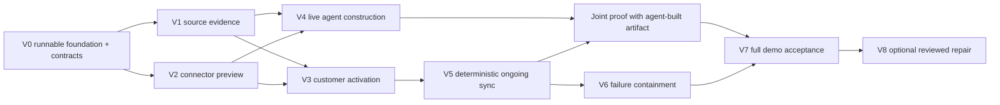

# Agent-Built Acquisition Connectors Implementation Plan

> **For agentic workers:** REQUIRED SUB-SKILL: Use superpowers:subagent-driven-development (recommended) or superpowers:executing-plans to implement this plan task-by-task. Steps use checkbox (`- [ ]`) syntax for tracking.

**Goal:** Build a locally reviewable, agent-generated connection for each of two acquired companies, then prove new records sync correctly through PostgreSQL with AI disabled.

**Architecture:** A control application investigates source evidence and builds immutable connector artifacts. A separate model-free worker activates explicitly reviewed customer connections and applies new source events transactionally to a simulated parent. Every vertical slice ends in an API/browser-visible outcome and a reproducible evidence packet.

**Tech Stack:** TypeScript, Node 24 LTS, npm workspaces, React/Vite, Fastify, Zod, `pg`, PostgreSQL 18, Vitest, Playwright, PDF.js, pdf-lib; OpenAI only in the design-time process.

**Spec:** [PRD v2](../../../prdv2.md). Read [shared contracts](2026-11-08-shared-contracts.md), [verification playbook](2026-11-08-verification-playbook.md), and [agent handoffs](2026-11-08-agent-handoffs.md) before execution.

**Status:** Planning only. Every checkbox is uncompleted. The repository currently contains only PRD documents; proposed files, scripts, test commands, and endpoints do not exist yet. No tests have been claimed as passing.

## Global Constraints

- “Explicit approval for each customer, authorizing subsequent automatic sync within that customer's approved rules.”
- “No model SDK or key in the runtime worker.”
- “Translation of existing financial systems and records, not issuance of new invoices or real money movement.”
- “One local PostgreSQL instance hosts two logical databases, `control` and `runtime`, with separate service roles and connection strings.”
- “Three customers per acquired company, three months of history, fixed monthly contracts, and USD.”
- “Suggested limits remain four simultaneous model calls, ten specialist tasks per customer investigation, eight tool rounds per task, and two focused repair rounds.”
- “Proposed demo defaults are USD 50,000 maximum per transaction and 1,000 records per cycle.”
- “Support full payment/credit reversals only, including reversal of all associated allocations.”
- All amounts use validated integer cents; PostgreSQL `BIGINT` values are parsed explicitly.
- Product agents are not coding agents. The three implementation lanes are all the user's Codex agents. Keep the existing PRD personnel wording unchanged.
- No builder declares a slice accepted merely because its own tests pass. Machine verification, independent review, and our joint acceptance are recorded separately.
- Do not start optional repair or polish before the required no-AI sync and drift-containment gates pass.

## Review Focus

- Concurrent approvals for a previously unseen customer must create one activation/bootstrap, not race around a missing lock row — T3.1.
- A new source version with the same economic record ID must not create a second invoice/payment — T5.1 and T6.1.
- A source page that repeats a cursor or contains conflicting duplicate IDs must not loop or advance capture silently — T1.2 and T5.1.
- Concurrent committed activity events must remain replayable after browser reconnect; PostgreSQL sequence allocation alone is not commit order — T0.1 and T4.1.
- A malformed decimal/date or ambiguous legal identifier must hold the affected record without rounding or broadening identity scope — T1.1 and T2.1.

Each focus item has a named test below. These supplement the PRD's expected happy paths.

---

## Delivery map and parallel lanes

| Slice | Visible outcome | Primary lane | Required dependencies | Joint gate |
|---|---|---|---|---|
| V0 | Open the app and see durable health/status from both isolated PostgreSQL services | B; C supplies minimal UI | None | Environment proof |
| V1 | Load either company and inspect records, source coverage, and exact evidence | A; C sources UI | V0 contracts | Evidence walkthrough |
| V2 | Preview a fixture connector and inspect independent validation results without parent writes | B; C preview UI/evaluator | V0; fixture data can precede V1 | Mapping/financial preview |
| V3 | Explicitly approve one customer and see its atomic parent import/receipt | C integration + B worker | V1+V2 | Approval walkthrough |
| V4 | Watch live collaborating agents build the connector shown in review | A; C monitor | V1+V2; V3 used at integration | Genuine AI construction |
| V5 | Inject new records and see automatic sync while model access is disabled | B; A sources/C monitor | V3; final gate additionally V4 | Core product proof |
| V6 | Replay, restart, revoke, and break a schema without corrupting the parent | B; A drift/C controls | V5 | Failure and recovery |
| V7 | Reproduce the full two-company demo with independent evidence | C + all | V4+V5+V6 | Demo acceptance |
| V8 optional | Investigate drift, approve a new connector version, and resume held work | A+B+C | V7 accepted | Optional repair review |

V1/V2 and the C UI fixtures can proceed concurrently after V0 publishes stable contracts. V4 and V3 can proceed concurrently after V1/V2. V5 can develop against an explicitly labeled fixture artifact while V4 is built; it is not finally accepted until exercised with the actual agent-produced artifact. Each slice is a product increment, not “finish the entire backend, then the frontend.”

**Critical path:** V0 → V2 → V3 → V5 → V6 → V7, with V4 joining before the final V5 proof. B's compiler/runtime work is the likely bottleneck; C owns the independent evaluator to avoid putting every verification task in B's queue. The first end-to-end proof uses one supported customer before extending to both source companies.

**Timebox:** first 60–90 minutes for V0 contracts/runnable foundation; aim for V1/V2 during the first half of day 1 and first activation plus live construction by its end. Day 2 prioritizes V5/V6 and the full two-company rehearsal. Optional day 3 addresses live reliability, presentation, and V8 only if required gates pass. These are planning targets, not completion guarantees. If behind, reduce source size and UI polish; do not omit explicit approval, financial invariants, both source modes, or AI-off proof.



## Execution and verification conventions

Create the repository map from the contracts document only as needed by each task. Every task follows a red/green cycle for its meaningful behavior, then focused review and a scoped commit. A failing import/setup step is not evidence the behavior fails for the expected reason: once the minimal module exists, observe the intended assertion failing before completing the implementation.

Root commands to establish in T0.1:

| Command | Contract |
|---|---|
| `npm run dev` | Start configured services after DB readiness/migrations; no automatic destructive reset |
| `npm run db:up` / `db:migrate` / `db:seed` | Local DB service, versioned migrations, idempotent demo seed |
| `npm run typecheck` | Type-check all implemented workspaces |
| `npm run test:unit -- <file>` | Vitest unit tests without DB/model access |
| `npm run test:integration -- <file>` | Vitest against isolated real PostgreSQL and actual service code |
| `npm run test:e2e -- <file>` | Playwright with isolated fixture DBs and controlled services |
| `npm run test:live -- <file>` | Explicit real provider calls; missing access fails with setup guidance, never a mock pass |
| `npm run verify:slice -- Vn` | Run that slice's registered checks and emit versioned evidence JSON/logs |
| `npm run demo:inject -- <scenario>` | Operator-only live source injection; prohibited from product tools |

The command registry is implemented in `scripts/verify-slice.ts`; it records every mandatory test file for each slice from this plan. Mid-slice work runs focused commands and is labeled partial; only a full slice run can pass that slice. Missing expected tests or skipped mandatory cases fail a verification run. Evidence is stored under ignored `.evidence/<commit>/<slice>/<runId>/`, never containing credentials. `docs/verification/` holds only reviewed summary records.

Assertion fragments below are the required assertions within the named tests; the preceding scenario supplies their setup/results. Test-only counter/query helpers belong in the test harness, never in product runtime.

## V0 — Open a running system with durable isolated services

### T0.1: Bootstrap through a visible PostgreSQL-backed health screen

**Owner:** B/integrator; C may supply the health component in a separate file.

**Files:** Create root workspace/config/lockfile, `.env.example`, `.gitignore`, `infra/compose.yaml`, `infra/init-databases.sh`, `scripts/{dev,migrate,seed,verify-slice}.ts`, `db/control/001_base.sql`, `db/runtime/001_base.sql`, `packages/contracts/src/*` listed in shared contracts, `packages/storage/src/{control-db,runtime-db,transaction,activity}.ts`, `apps/{control,worker}/src/server.ts`, `apps/web/src/{main,App}.tsx`, `apps/web/src/features/health/HealthPage.tsx`. Tests: `tests/integration/v0-foundation.test.ts`, `tests/e2e/v0-health.spec.ts`, `tests/fixtures/{index,harness}.ts`.

**Interfaces:** Produce shared Zod/TS contracts, injected service builders, `GET /api/health`, worker health, DB/migration helpers, and `ActivityEvent` persistence. Health response `{controlDb:'ready',runtimeDb:'ready',migrationVersions:{control,runtime}}`; worker status is fetched through its service boundary.

- [ ] Write foundation assertions: health is 200 only after both services' migrations; control role cannot connect to runtime and vice versa; seed twice leaves one seed version; a committed status event survives service restart; browser renders both services ready. Add a two-transaction activity test that forces reversed completion order and proves cursor replay loses no event.

```ts
expect(health.body).toMatchObject({controlDb:'ready', runtimeDb:'ready'});
expect(replayedCommittedEventIds).toEqual(expectedCommittedEventIds);
```
- [ ] Run `npm run test:integration -- tests/integration/v0-foundation.test.ts` and `npm run test:e2e -- tests/e2e/v0-health.spec.ts`; observe missing/incorrect readiness, isolation, or persistence behavior before implementing it.
- [ ] Implement the listed files. Use a transaction helper with one checked-out `pg` client; persistent named PG volume; separate migration/application roles; safe test DB name prefix. Root `.gitignore` excludes secrets, raw generated artifacts, truth output, and `.evidence`. The activity cursor uses the locked sequence-row rule from shared contracts.
- [ ] Run `npm run typecheck` and `npm run verify:slice -- V0`. Expected: all V0 tests pass, two DBs remain isolated, reload/restart preserves the committed status, no model key needed. Record dependency/image versions and command exit codes.
- [ ] Review only V0 changes, commit `feat: add PostgreSQL-backed local application foundation`, and provide the evidence packet for Gate G0. No claims of migration capability yet.

## V1 — Inspect both acquired companies and their evidence

### T1.1: Ingest a source bundle and open exact supporting records

**Owner:** A; C owns sources UI.

**Files:** Create `scripts/generate-fixtures.ts`, `packages/sources/src/{canonical-fixtures,company-a,uploads,dossier}.ts`, `packages/evidence/src/{store,extract,locate,search}.ts`, `apps/control/src/routes/sources.ts`, `apps/web/src/features/sources/{SourcesPage,EvidencePanel}.tsx`, `db/control/002_sources.sql`. Tests: `tests/integration/v1-evidence.test.ts`, `packages/evidence/test/locate.test.ts`, `tests/e2e/v1-sources.spec.ts`.

**Interfaces:** Consume `BootstrapManifest`, `EvidenceRef`, `Finding`; produce source upload/dossier/evidence routes and `captureSnapshot(manifestId): Promise<SourceSnapshot>`. Generator writes visible inputs separately from protected truth; source adapters expose no truth path.

- [ ] Write tests asserting the A baseline contains a 300000-cent invoice, 200000 payment allocation, and 20000 credit with retrievable references; a cited PDF page/CSV row opens the exact stored bytes/text; duplicate upload has one content identity. Reject missing citation, malformed PDF/CSV, traversal filename, source files outside root, and ambiguous legal-entity merge. Browser opens a citation and exposes incomplete coverage instead of a success badge.

```ts
expect(evidence.excerpt).toBe(expectedSourceExcerpt);
expect(duplicateUpload.contentHash).toBe(firstUpload.contentHash);
expect(incompleteDossier.complete).toBe(false);
```
- [ ] Run the V1 evidence unit/integration/browser files and observe the intended failures. Confirm no test silently substitutes fixture truth for visible evidence.
- [ ] Implement snapshot storage, deterministic PDF text extraction with page offsets, CSV and email JSON parsing, bounded evidence search, and UI. Store original bytes; a new upload version never edits the old record. Limit upload to 10 MiB/file and report rejected/unsupported input explicitly. Make template-based source generation reproducible without LLM use.
- [ ] Run the T1.1 unit/integration/browser commands and typecheck; mark V1 incomplete until T1.2 also passes. Expected: exact provenance, duplicate-safe capture, visible errors, preserved entities.
- [ ] Commit `feat: ingest acquisition records with inspectable evidence`; deliver a dossier/evidence packet, not a model accuracy claim.

### T1.2: Make Company B's file/API baseline and future streams reproducible

**Owner:** A.

**Files:** Create `packages/sources/src/{company-b,manifest,change-feed,scenario-admin}.ts`, add routes via `apps/control/src/routes/sources.ts`. Tests: `tests/integration/v1-manifests.test.ts`, `packages/sources/test/change-feed.test.ts`. Modify only fixtures needed for the source scenarios.

**Interfaces:** Produce `getManifest(companyId): Promise<BootstrapManifest>`, `getSnapshot(snapshotId): Promise<SourceSnapshot>`, `fetchChanges(sourceRef,streamId,after): Promise<ChangePage>`. Company B exposes separate file, receipt, and semantic stream cursors; source admin controls injection, inaccessible to product agents.

- [ ] Write tests: all B baseline members share a canonical epoch; missing file or changed hash blocks capture; a payment injected during baseline review appears strictly after its API cursor; same batch/same bytes is a no-op and same batch/different bytes conflicts; cursor regression, nonadvancing nonempty page, missing batch, and conflicting event IDs are rejected. Required semantic version accompanies each financial event.

```ts
expect(baselineManifestB.streams).toHaveLength(3);
expect(changedBatchResponse.status).toBe(409);
expect(afterBaseline.events.map(event => event.id)).toContain(injectedPayment.id);
```
- [ ] Run `npm run test:integration -- tests/integration/v1-manifests.test.ts` and the change-feed unit test; observe failures for missing boundaries/conflicts.
- [ ] Implement append-only source event exports, coordinated manifests, complete-page cursors, and operator scenarios. Use stable namespaced transaction identities, not CSV row positions. Never use one timestamp as a combined file/API checkpoint.
- [ ] Run `npm run verify:slice -- V1`. Expected: both dossiers inspectable; multi-stream baseline is complete or visibly blocked; exact future events retrievable once by stable identity. Walk through Gate G1 with us.
- [ ] Commit `feat: add coordinated file and API acquisition snapshots`.

## V2 — Preview an executable connector without writing the parent

### T2.1: Compile the restricted mapping language and reconcile a preview

**Owner:** B.

**Files:** Create `packages/compiler/src/{compile,canonicalize,plan-batch,operations}.ts`, `packages/finance/src/{balance,allocations,reversals,validate}.ts`, `packages/parent/src/state.ts`, `apps/control/src/routes/preview.ts`. Tests: `packages/compiler/test/{compile,plan-batch}.test.ts`, `packages/finance/test/finance.test.ts`, `tests/integration/v2-preview.test.ts`.

**Interfaces:** Produce `compile`, `planBatch`, `computeBalance` exactly as shared contracts. Preview route accepts a draft spec/profile/snapshot reference and returns a plan/diff/diagnostics; it has no target-write capability.

- [ ] Write named tests `canonical_hash_ignores_object_key_order`, `rejects_unknown_operation`, `preview_preserves_parent`, `preserves_source_money`, `rejects_ambiguous_date`, and `reverses_full_payment_once`. Pin these assertions:

```ts
expect(computeBalance(baselineA, '2026-10-01T00:00:00Z')).toBe(80000);
expect(computeBalance(afterLatePaymentA, '2026-10-03T00:00:00Z')).toBe(50000);
expect(parseMinorUnits('1.005')).toEqual({ok:false, code:'MONEY_SCALE'});
expect(parseMinorUnits('12.34')).toEqual({ok:true, cents:1234});
```

`parseMinorUnits` is exported from `packages/compiler/src/operations.ts`; `afterLatePaymentA` is a public fixture derived from an explicit payment/allocation, not an inferred transaction. Also assert over-allocation, cross-seller allocation, unsafe integer, unknown currency, overlapping contract intervals, and partial reversals produce blockers.

- [ ] Run the compiler/finance unit files and V2 preview integration file; observe the specified failures before completing the implementation.
- [ ] Implement only the enumerated DSL operations; compiler injects mandatory validators independent of agent suggestions. Emit canonical hash, required versions, source lineage, and explicit unsupported diagnostics. Arithmetic works on exact integer cents. Parent schema is minimal v1 from contracts, with no invoice-issuance route.
- [ ] Run the T2.1 compiler/finance/preview test files, plus typecheck. Expected: deterministic repeated preview, correct balance, zero parent writes, unsupported logic held. V2 remains partial until T2.2.
- [ ] Commit `feat: compile connector plans and validate financial previews`.

### T2.2: Independently verify the artifact and make the report reviewable

**Owner:** C owns independent harness/UI; B exposes compile/preview.

**Files:** Create `packages/evaluator/src/{verify,reference-model,fixtures,runner}.ts`, `apps/control/src/routes/verification.ts`, `apps/web/src/features/preview/{PreviewPage,VerificationReport}.tsx`, `db/control/003_artifacts.sql`. Tests: `tests/integration/v2-verification.test.ts`, `tests/e2e/v2-preview.spec.ts`.

**Interfaces:** Produce `verifyArtifact` and registry-issued immutable `VerificationReport`. Control routes persist hash-bound report and render field diffs, evidence, independent tests, and unsupported rows. The evaluator is a separate command/process; no model tool accesses its truth files.

- [ ] Write tests: a deliberately wrong mapping preserving types but swapping amounts fails the independent expected output; a forged passing report is not accepted; changing artifact/profile/manifest invalidates report reuse; unresolved evidence correctly blocks rather than guessing. Assert protected expected values are absent from tool responses and exposed HTTP/file routes.

```ts
expect(wrongMappingReport.eligible).toBe(false);
expect(wrongMappingReport.unexplainedDifferenceCents).not.toBe(0);
expect(forgedReportResponse.status).toBe(403);
```
- [ ] Run V2 verification integration/browser tests and observe failures for missing independence/hash binding.
- [ ] Implement an independent seeded reference model that does not import compiler/finance functions, protected holdouts, report persistence, and preview screen. Agent-authored tests are displayed separately from mandatory checks. Limit verification attempts during discovery and hold a separate final unseen variant outside repair feedback.
- [ ] Run `npm run verify:slice -- V2`. Expected: A/B fixture artifacts can be previewed, faulty mapping rejected, material unsupported terms visible, and target unchanged. Review Gate G2 with us.
- [ ] Commit `feat: verify connector artifacts independently before review`.

## V3 — Approve one customer and inspect the parent import

### T3.1: Make activation atomic, scoped, and repeatable

**Owner:** B worker; C reviewer routes.

**Files:** Create `db/runtime/002_finance.sql`, `db/control/004_review.sql`, `packages/runtime/src/{activate,authorization,receipts}.ts`, `packages/parent/src/{repository,views}.ts`, `apps/control/src/routes/review.ts`, `apps/worker/src/routes/activation.ts`. Tests: `tests/integration/v3-activation.test.ts`.

**Interfaces:** Consume registered artifact/profile/report and `ReviewPackage`; produce `activateCustomer`, `/api/review/:accountId`, reviewer activation route, private worker activation, and parent/receipt reads. Reviewer context is server-generated; agents cannot invoke this route through their tool registry.

- [ ] Write tests: unapproved target has zero records; explicit valid activation imports $800 baseline; duplicate same request returns the same receipt; conflicting reused idempotency key returns 409; unknown customer/source grant returns 403/422; changed artifact/profile/target version returns 409. Race two first approvals for the same account and assert exactly one bootstrap, no duplicate allocation, and consistent receipt.

```ts
expect(parent.balanceCents).toBe(80000);
expect(replayedReceipt.id).toBe(firstReceipt.id);
expect(await countActivations(scopeA)).toBe(1);
```
- [ ] Run `npm run test:integration -- tests/integration/v3-activation.test.ts`; observe intended authorization/atomicity failures.
- [ ] Implement transaction-scoped activation and target writes with unique scope/idempotency keys, insert-or-lock activation, row locking, and current source semantic checks. A routine new source event after baseline does not stale the approval; a new binding semantic revision does. Inject failpoints before commit/after commit for later tests; failpoints are test-only.
- [ ] Run the V3 activation tests and typecheck. Expected: an injected precommit exception leaves zero partial target writes; lost reply after commit is recoverable by receipt; other accounts remain untouched. Record SQL assertions in evidence.
- [ ] Commit `feat: activate reviewed customers with atomic parent imports`.

### T3.2: Deliver the explicit customer review workflow

**Owner:** C.

**Files:** Create `apps/web/src/features/review/{ReviewPage,FutureScope,CorrectionForm}.tsx`, `apps/web/src/features/connections/ParentView.tsx`, `packages/client/src/{review,parent}.ts`; extend review routes for corrections. Tests: `tests/e2e/v3-review.spec.ts`, `tests/integration/v3-corrections.test.ts`.

**Interfaces:** Review exposes exact hashes, per-field evidence, initial balance, future allowed operations/limits, and “Approve and enable this customer.” Corrections produce a new candidate/profile revision and require verification again; never mutate approved source snapshots.

- [ ] Write browser tests: open one account, inspect PDF evidence and $800 balance, see future-sync scope, click explicit enable, inspect parent records/receipt; the second account remains inactive. Double-click does not duplicate import. Unsupported material term disables activation with a server-confirmed blocker. Cited transcription correction may become reviewable; unsupported invented price remains blocked.

```ts
await expect(page.getByRole('button', {name:'Approve and enable this customer'})).toBeVisible();
expect(secondAccount.status).toBe('inactive');
expect(unsupportedPricePackage.ready).toBe(false);
```
- [ ] Run the review browser/correction integration tests and observe failures for missing stale/review behavior.
- [ ] Implement the UI/client/routes, using actual worker reads for parent state. Clearly identify local demo reviewer identity. Render a stale-version response with reload/review instructions rather than automatically resubmitting an approval against changed data.
- [ ] Run `npm run verify:slice -- V3`. Expected: a real reviewer action across UI/control/worker/PostgreSQL produces one parent import and immutable receipt. Review Gate G3 with us.
- [ ] Commit `feat: add evidence-backed customer activation review`.

## V4 — Let collaborating agents construct the reviewed connector

### T4.1: Persist bounded agent work and stream observable actions

**Owner:** A; C monitor UI.

**Files:** Create `packages/discovery/src/{model,coordinator,roles,tools,tasks,budgets}.ts`, `apps/control/src/routes/{discovery,events}.ts`, `db/control/005_discovery.sql`, `apps/web/src/features/agents/{AgentPage,TaskTimeline,ToolInspector}.tsx`. Tests: `tests/integration/v4-agent-tools.test.ts`, `tests/e2e/v4-monitor.spec.ts`.

**Interfaces:** `ModelClient.run(input: ModelTurn): Promise<ModelResult>` uses role instructions plus visible tool results; `startDiscovery({companyId,manifestId}): Promise<{runId}>`; `getDiscovery(runId): Promise<DiscoveryState>`. Add `ModelTurn`, `ModelResult`, `DiscoveryState`, `TaskContext` schemas with the integrator before consumers. Produce persisted ActivityEvents and cursor-replay SSE, including pause/resume.

- [ ] Write scripted-model tests: coordinator delegates identity/contract/receivables work and connector engineer requests evidence; no role can call activate/apply/source-admin/SQL or read fixture truth; wrong-company citation/query fails scope; injection text cannot extend permissions; four-call global cap and task/tool/repair limits are enforced; pause persists and resume does not duplicate completed task writes. Browser reconnect after concurrent events loses no committed event.

```ts
expect(forbiddenToolResult.code).toBe('TOOL_FORBIDDEN');
expect(maxObservedConcurrentModelCalls).toBeLessThanOrEqual(4);
expect(parentWriteCount).toBe(0);
```
- [ ] Run V4 agent-tool and monitor files with a scripted test model. Observe failures in permissions/bounds/replay. Scripted tests verify orchestration, not model competence.
- [ ] Implement bounded persistent tasks, per-role tool registries, validated tool input/output, finding revision checks, and monotonic event publication. Tool messages cannot modify reviewer identity or approval state. Show task/evidence/tool summaries, costs, and blockers; no chain-of-thought UI.
- [ ] Run the T4.1 agent-tool and monitor tests; explicitly report V4 live construction as pending. Do not mark the full V4 slice passed. Expected: deterministic enforcement despite malicious tool requests and resumable observer UI.
- [ ] Commit `feat: add observable bounded connector-building agents`.

### T4.2: Build and verify genuine artifacts from both source companies

**Owner:** A; C owns final holdout/evidence capture.

**Files:** Create `packages/discovery/src/{openai-client,connector-engineer,readiness}.ts`, `tests/live/v4-build-connectors.test.ts`, `scripts/live-build.ts`. Modify role prompts without changing shared mandatory validators.

**Interfaces:** Live `ModelClient` implementation; generated `ConnectorSpec` and `CustomerProfile` revisions flow through `compile` and protected `verifyArtifact`, not a hardcoded company artifact. Provider model ID/configuration is recorded in the run.

- [ ] Write the live test assertions: tool trace contains real evidence retrieval and cross-role tasks; generated A/B mappings use their differing schemas; compiled artifacts reconcile correctly; an unsupported term remains blocked; final holdout with changed customer names/amounts remains correct or correctly held. Assert no company-specific final artifact was read from dev fixtures.

```ts
expect(realProviderCallIds.length).toBeGreaterThan(0);
expect(generatedArtifacts.map(a => a.sourceRef).sort()).toEqual(['legacy-a','legacy-b']);
expect(supportedCustomerReports.every(r => r.eligible)).toBe(true);
```
- [ ] Run `npm run test:live -- tests/live/v4-build-connectors.test.ts`; verify missing provider configuration produces an explicit failure, not a skip/pass. With access configured, capture actual pre-fix outputs and any failed material assertions.
- [ ] Implement provider adapter and connector-engineer instructions/output validation. Keep credentials backend-only. Let agents choose queries and revise proposals within bounded rounds; expose uncertainty and exhausted budgets. Do not edit the protected expected results to match agent output.
- [ ] Run `npm run verify:slice -- V4` with both live and deterministic tests; record artifact hashes, provider calls/tokens, holdout outcomes, and failure diagnostics. Review Gate G4 with us. A replay or test double cannot satisfy this gate.
- [ ] Commit `feat: construct verified connectors with live discovery agents` after focused review of prompts, tools, and evidence boundaries.

## V5 — Keep the connection running with no AI

### T5.1: Capture and apply new source events transactionally

**Owner:** B; A source adapters.

**Files:** Create `db/runtime/003_sync.sql`, `packages/runtime/src/{capture,apply,run-cycle,dependencies,checkpoints}.ts`, `apps/worker/src/routes/sync.ts`. Tests: `tests/integration/v5-sync.test.ts`, `packages/runtime/test/dependencies.test.ts`.

**Interfaces:** Implement `capturePage`, `applyBatch`, `runCycle` and dependency grouping using V1 source adapters/V2 plans. Persist capture and application progress separately. All source-side I/O happens outside SQL transactions.

- [ ] Write tests: $300 postactivation payment yields 50000 cents, cutover remains 80000; new source invoice is imported; same event replay and same economic record under another connector version do not duplicate money; payment before invoice waits, then later invoice releases it; unallocated cash stays separate; unsupported/over-limit event held. Assert snapshot-to-stream event during approval is not lost, and unknown semantic version blocks application before metadata arrives.

```ts
expect(current.balanceCents).toBe(50000);
expect(cutover.balanceCents).toBe(80000);
expect(appliedEconomicIdentities.filter(id => id === latePaymentIdentity)).toHaveLength(1);
```
- [ ] Run `npm run test:integration -- tests/integration/v5-sync.test.ts` plus dependency unit tests; observe intended loss/replay/dependency failures before implementing.
- [ ] Implement cursor CAS under stream lock; customer epoch/target version checks under activation lock; mandatory financial validations at application time; source/economic identity uniqueness independent of connector version; atomic target/receipt/outcome writes. Captured pending prerequisites remain available to resolve holds. Changed monetary record contents without supported reversal are held.
- [ ] Run the T5.1 sync/dependency tests with model access disabled. Expected: all fixture transactions correct, quarantined gaps visible, no progress labeled fully applied past an unresolved gap, and no worker model dependency. V5 final live gate waits for T5.2 and V4.
- [ ] Commit `feat: synchronize approved customer records without model calls`.

### T5.2: Expose live connection health and prove operation without credentials

**Owner:** C; B isolated worker startup.

**Files:** Create `apps/web/src/features/connections/{ConnectionsPage,ConnectionDetail,ReceiptDetail}.tsx`, `apps/control/src/routes/connections.ts`, `packages/client/src/connections.ts`, `scripts/{start-worker,inject-scenario}.ts`, `tests/e2e/v5-ai-off.spec.ts`, `tests/integration/v5-runtime-isolation.test.ts`.

**Interfaces:** Connection state/receipts come from worker-authoritative reads. Operator injection creates events only after activation. Worker startup allowlists its environment and network destinations; control keeps source mocks available while its model adapter is disabled.

- [ ] Write browser/integration assertions: worker has no provider SDK dependency or model key; attempted external model calls fail in the test harness; disable control model client, inject fresh A payment and B file batch, run cycle, and see updated parent receipts with zero runtime calls. Add unknown customer and assert it appears held without gaining authorization.

```ts
expect(runtimeProviderAttempts).toBe(0);
expect(connection.runtimeModelCalls).toBe(0);
expect(unknownCustomerTargetRows).toHaveLength(0);
```
- [ ] Run V5 browser/isolation files against isolated services and observe initial failures. Ensure postactivation events are not in replay caches or discovery snapshots.
- [ ] Implement connection status, capture/application lag and gap counts, rule trace/receipt views, explicit injection scripts, and environment/network boundary tests. Any “AI off” indicator must reflect actual configuration/test evidence rather than a hardcoded marketing badge.
- [ ] Run `npm run verify:slice -- V5`, then repeat the scenario using V4's live-produced artifacts. Review Gate G5 together: turn off AI, inject records after the toggle, inspect SQL/receipts and parent output. Neither fresh human approval nor a model call may be needed for conforming records.
- [ ] Commit `feat: monitor and prove AI-free ongoing synchronization`.

## V6 — Contain failures and preserve financial state

### T6.1: Verify retries, crashes, revocation, and PostgreSQL races

**Owner:** B; C independent integration review.

**Files:** Create `packages/runtime/src/{control,retry}.ts`, `apps/worker/src/routes/control.ts`, extend `apply.ts` with test-only failpoint injection, and add `tests/integration/v6-recovery.test.ts`.

**Interfaces:** Implement `setConnectionStatus`; deterministic failure codes and three-attempt whole-transaction retry policy. Production config has no HTTP-accessible failpoint surface.

- [ ] Write tests with barriers, not sleeps: crash after capture/before application preserves inbox; rollback before commit leaves no target effect; crash after commit/retry returns receipt; two workers consuming same group have one effect; revoke acquires same activation lock and stale plans cannot commit after revocation; target conflict held; resuming a revoked connection is rejected and requires fresh review. Test a deadlock/serialization failure triggers bounded full retry and no duplicated side effect.

```ts
expect(afterRetry.receiptId).toBe(committedReceiptId);
expect(staleEpochResponse.status).toBe(409);
expect(afterRollback.targetRows).toEqual(beforeTransaction.targetRows);
```
- [ ] Run V6 recovery integration tests repeatedly against actual PostgreSQL to demonstrate initial failures. Distinguish request arrival from lock/commit order in revoke assertions.
- [ ] Implement pause/revoke epoch changes, stable lock order, retry classification, receipt recovery, and worker restart reconciliation. A transaction that committed before revocation remains valid; revocation response is sent only after its own commit.
- [ ] Run `npm run test:integration -- tests/integration/v6-recovery.test.ts` and V5 regression files. Expected: invariant counts/balances preserved across each injected boundary and no spurious green for an unexecuted race test.
- [ ] Commit `feat: preserve synchronization integrity across crashes and revocation`.

### T6.2: Stop changed schemas or contracts before bad writes

**Owner:** A drift sources; B runtime classifier; C controls/exception UI.

**Files:** Create `packages/runtime/src/{drift,quarantine}.ts`, `apps/web/src/features/connections/{ExceptionPanel,ConnectionActions}.tsx`, extend source operator scenarios. Tests: `tests/integration/v6-drift.test.ts`, `tests/e2e/v6-containment.spec.ts`.

**Interfaces:** Use typed `Hold`, connection status, semantic dependencies, scope-aware pause, and evidence links. No repair/model call is permitted from worker drift detection.

- [ ] Write tests: renamed/removed amount field pauses A before writes while B continues; unknown required enum fails; new scoped amendment holds that account; unscoped governing document pauses its source; changed bytes for a known CSV batch conflict; unsupported partial reversal held; parent-side version conflict does not overwrite. Metadata arriving after a dependent financial event still prevents premature application.

```ts
expect(sourceAState.status).toBe('paused');
expect(sourceBState.status).toBe('active');
expect(rejectedEventTargetRows).toHaveLength(0);
```
- [ ] Run V6 drift integration/browser tests and observe expected missing-containment failures.
- [ ] Implement deterministic classification, visible quarantine diagnostics/dependencies, manual pause/revoke controls, and an “Investigate” action that creates an explicit control-plane request. Do not automatically enable model access or broaden authority.
- [ ] Run `npm run verify:slice -- V6` plus affected V5 checks. Review Gate G6 together: break one connection, confirm unchanged financial rows for rejected input, and show an independent connection still working. Same-shape semantic drift detection remains an explicit limitation.
- [ ] Commit `feat: quarantine schema and contract drift without AI fallback`.

## V7 — Demonstrate and independently accept the complete product

### T7.1: Produce a repeatable two-company verification packet

**Owner:** C; all lanes fix owned failures.

**Files:** Create `scripts/{rehearse,collect-evidence}.ts`, `tests/e2e/v7-demo.spec.ts`, `tests/live/v7-holdout.test.ts`, `docs/demo/runbook.md`, `docs/verification/template.md`. Extend verification registry with all mandatory slice checks.

**Interfaces:** Consume actual live-produced artifacts, source manifests, receipts, independent reports, and completed test commands. Produce versioned evidence packets and manual acceptance records; no fabricated test counts or acceptance statuses.

- [ ] Write full scenario assertions: both acquisitions investigated by live agents, explicitly activated, fresh records sync after AI disabled, duplicate replay no-op, restart recovery, drift containment, readable remaining exceptions, preserved original snapshot, and correct current balance. Require the separate final unseen variant; do not feed its expected answers to repair agents.

```ts
expect(fullRun.runtimeProviderAttempts).toBe(0);
expect(fullRun.duplicateEconomicEffects).toBe(0);
expect(fullRun.independentReconciliationDifferencesCents).toEqual([0, 0]);
```
- [ ] Run V7 browser test with a deterministic construction fixture first to debug presentation wiring, clearly labeled; then run `npm run test:live -- tests/live/v7-holdout.test.ts` with genuine artifacts. Missing live evidence is a failure of the live gate.
- [ ] Implement rehearsal script and redacted evidence collector. Record commit, migrations, source/artifact/profile hashes, model configuration, commands/exit statuses, receipts, screenshot or video, and unresolved limitations. A user review field stays `pending` until the user actually reviews it.
- [ ] Run three complete live rehearsals with distinct IDs and report each result, including failures. Review Gate G7 together using the playbook. Record measured timing/cost and correction counts; do not claim production correctness or savings from a synthetic demo.
- [ ] Commit `test: add repeatable two-company acceptance demonstration` and prepare the final integration review. User approval of a slice is not authorization for real financial writes or deployment.

## V8 — Optional reviewed repair after the core demo passes

### T8.1: Replace a broken connector without replaying old money

**Owner:** A/B/C in their owned modules.

**Files:** Create `packages/discovery/src/repair.ts`, `packages/runtime/src/switch-version.ts`, `apps/web/src/features/review/VersionDiff.tsx`, `tests/integration/v8-upgrade.test.ts`, `tests/e2e/v8-repair.spec.ts`.

**Interfaces:** `proposeRepair({connectorId,incidentId}): Promise<{runId}>`; `switchVersion({scope,expectedEpoch,reviewPackageId},actor): Promise<CustomerActivation>`. Requires explicit request, independently verified new artifact, and renewed affected-customer approval.

- [ ] Write tests: renamed field produces N+1 after explicit investigation; old customers stay pinned until reviewed; switch serializes against apply/revoke; held records resume once; old events do not become new monetary transactions; a changed mapping requiring historical financial correction remains held.

```ts
expect(reapproved.epoch).toBe(previous.epoch + 1);
expect(appliedHistoricalEconomicIdentities).toEqual(beforeSwitchEconomicIdentities);
expect(unsupportedCorrection.status).toBe('held');
```
- [ ] Run V8 tests and observe initial unsupported version-switch behavior.
- [ ] Implement nonfinancial schema repair, artifact diff, reapproval, and atomic version/epoch switch. No automatic reversal of already committed parent history.
- [ ] Run `npm run verify:slice -- V8` and relevant V5/V6 regression files; jointly inspect version differences and held-event replay.
- [ ] Commit `feat: repair and reapprove changed connector versions` only if the required V7 outcome remains stable.

## Completion and handoff

Run the self-review against PRD sections 1–20 and the verification matrix before starting implementation. The plans do not waive source/approval constraints or replace actual checks. At each joint gate, provide a short outcome-first report and the precise commands/screens for us to inspect; independent tasks may continue while review is pending, but dependent work must not silently treat a rejected interface or behavior as approved.

This plan covers implementation decisions and verification. It does not start services, create product code, or run the proposed tests. The next execution increment is V0, followed by parallel V1/V2/C review-shell work against the published contracts.
