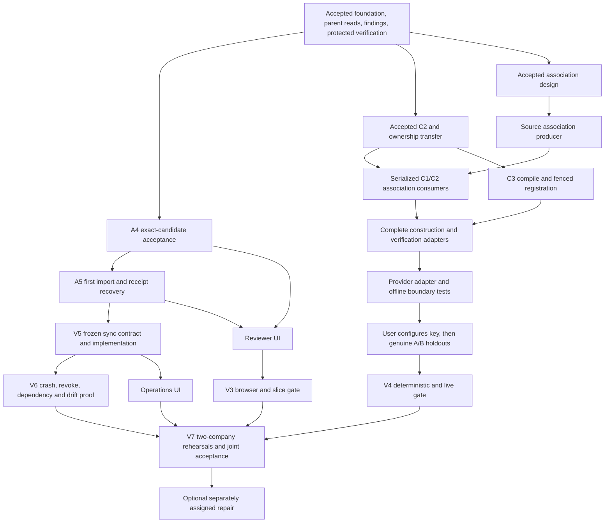

# Three-Developer Expansion Handoff and Implementation Plan

> **For agentic workers:** Use `superpowers:executing-plans` for each explicitly dispatched task. The integrator assigns bounded Sol implementation and independent Astra design/code review. Do not start dependent work, create additional agents, or take another owner's files merely because this roadmap lists them.

**Goal:** Add two developers, transfer discovery and product presentation to them, and narrow the existing team to financial authority, deterministic runtime, shared contracts and integration.

**Architecture:** Preserve the existing control/runtime database and process separation. Discovery produces evidence-bound proposals and registered candidates; explicit reviewer approval produces a durable intent; only the worker can commit authority and imported records. UI consumers observe those states without creating their own authority.

**Tech stack:** Node 24, strict TypeScript/npm workspaces, Fastify, React/Vite, PostgreSQL 18/`pg`, Zod, Vitest, Playwright, PDF.js and pdf-lib. No new framework or dependency is implied.

**Spec:** [PRD v2](../../../prdv2.md), [original implementation plan](2026-11-08-implementation-plan.md), [shared contracts/ownership](2026-11-08-shared-contracts.md), [verification playbook](2026-11-08-verification-playbook.md). This is a coordination and dispatch plan, not a replacement financial specification or evidence of completion.

## 1. Read this first

There will be **three developer ownership lanes**, not five: the existing team becomes the platform/integration lane; two new developers take discovery and reviewer/operations presentation. The earlier A/B/C labels described the user's agent workstreams. They were not three additional human developers. Historical task labels such as A4, C2 and C3 remain useful identifiers but do not name the new developers.

The recommended split is:

| Lane | Accountable owner | Owns remaining outcome | Explicitly hands away |
| --- | --- | --- | --- |
| Platform | Existing team and integrator | A4/A5 authority, V5/V6 runtime, shared schemas, protected evaluator boundaries, migrations/composition and final integration | Discovery construction after accepted C2 transfer; reviewer/operations UI and demo coordination |
| Discovery | New developer 1 | Supported document association, accepted C2 follow-through, C3 registration, remaining discovery tools, provider integration and genuine A/B builds | Approval, runtime writes, protected expectations, UI authority |
| Experience | New developer 2 | Reviewer workflow, discovery detail views, connection operations, browser evidence and V7 rehearsal | Financial decisions, new grants, runtime transaction behavior, live construction implementation |

This split reduces active cross-cutting implementation by the existing team. The existing team retains **A4** ownership; its WIP is preserved and no implementation agent continues work at this checkpoint. The C2 correction has now been accepted and integrated; its exact transfer is described below. New developers do not duplicate completed work or take A4 files. Ownership transfer is an explicit record containing accepted commit, released paths, tests, remaining findings and dependency contracts.

### Authority and reading order

1. Read root and applicable area `AGENTS.md`; then PRD §§1, 7, 10–14, 17–21.
2. Read [freeze v1](2026-11-08-contract-freeze.md), [activation shapes](2026-11-08-contract-freeze-v2-activation-shapes.md), [bootstrap claims](2026-11-08-contract-freeze-v3-bootstrap-verification.md), [discovery shapes](2026-11-08-contract-freeze-v3-discovery-shapes.md), and [activation authority](2026-11-08-contract-freeze-v4-activation-authority.md).
3. Read the **latest sections** of [progress checkpoint](../../progress/2026-11-08/README.md), followed by your task's tracked handoff and exact-candidate review. Its earlier sections are historical checkpoints.
4. Treat old illustrative paths, migration numbers and API signatures in the original plan as superseded where later freezes/accepted code say otherwise. In particular, there is no current `packages/runtime` workspace; A5 uses worker app modules. Discovery persistence is control007, not the original illustrative control005.

## 2. Evidence-qualified current state

**Coordination snapshot:** published accepted main/code integration `d91a1af393584159d327dcdeaa7212acc7bf3d2d` (C2 corrected candidate `ced4a6a275f561fc56cb6cd2e55ae20d81442f0b` integrated after `67d0369`); resolve full SHAs before branching. Changes accepted after this snapshot require an updated transfer record. This document was prepared by reading code and records; it does not claim new product tests were executed.

“Observed” below means documented implementation or machine/browser evidence in the checkpoint. “Inference” means a dependency conclusion drawn from that evidence. “Pending” means no accepted end-to-end proof. Independent review and joint user acceptance remain separate from machine checks.

| Slice / PRD requirement | Observed implementation and evidence | Remaining work / limitation | Owner |
| --- | --- | --- | --- |
| V0 / isolated durable services | Health, migrations, roles, native startup; V0 gate passed | Preserve isolation through later composition; whole-workflow acceptance pending | Platform |
| V1 / inspect original evidence | A/B captures, exact citations, dossier/coverage, read tools; V1 gate passed | Supported agreement-to-account association is a separate prerequisite; arbitrary document interpretation is not implemented | Discovery |
| V2 / zero-write preview and independent financial checks | Compiler/planner, protected v2 checks, actual-v2 browser evidence; V2 gate passed | Fixture candidate construction is not live generation; financial eligibility alone is not bootstrap/activation readiness | Platform; Experience regression |
| V3 / explicit customer approval | Bootstrap planner/checker/registry, attested financial provenance, policy publication, runtime storage and authenticated parent reads accepted | A4 pending-intent WIP preserved; A5 worker import/recovery and reviewer UI not accepted | Platform → Experience |
| V4 / genuine agent construction | Durable bounded lifecycle/delegation, source read tools, findings, activity/SSE and Discovery monitor accepted | C2 accepted; association implementation, C3, remaining tools, provider and genuine held-out A/B runs incomplete | Discovery |
| V5 / standing authority with AI off | Compiler, financial invariants and activation storage are prerequisites | No operational ongoing capture/apply/checkpoint loop; no new post-activation input proof | Platform → Experience |
| V6 / failures and recovery | Component rollback/race/authority protections have focused tests | Complete sync crash/replay/revocation/dependency/drift proofs absent | Platform |
| V7 / complete product demonstration | Source/preview/monitor screens and safe evidence-packet machinery exist | Full two-company workflow, three rehearsals, final review and joint acceptance absent | Experience, all lanes |
| V8 / optional repair | PRD describes reviewed repair/version changes | Optional after mandatory V0–V7; no promise of completed repair/reapproval | Later explicit assignment |

**Three of eight mandatory slice gates have passed.** This is not 37.5% of effort and does not establish the other five gates. V8 is optional. Gate packets apply to their exact recorded commits/configurations, not automatically to every descendant.

The running supervisor was restarted on `d91a1af`; health reports control007/runtime002 ready, two registered parent candidates without diagnostics, both inactive, and all 253 original source/pin hashes preserved. Latest recorded balance evidence from the parent-read workflow is Company A $800 and Company B $0, both inactive, with zero preview parent writes. Company B's unidentified $300 remittance remains held. The original 253 source/pin file hashes were preserved. These observations do not show imported parent balances or money movement. The selected development profiles cover only part of each company; source observations do not approve parent identity.

The default composition has **no configured model client**. Scripted real-service monitor tests demonstrate lifecycle behavior, not live model competence. Model-key configuration remains deferred by the user; no task in this handoff authorizes provisioning or using a live key now.

### In-flight work that must not be duplicated

| Item | Snapshot status | Transfer gate |
| --- | --- | --- |
| A4 `codex/activation-review`, existing source worktree | Remote clean WIP `78f355e49925b30cffa6b380b0a28f153d40376b`; typecheck and 82 PostgreSQL tests across 18 files reported passing; adversarial gaps remain in [report](../../progress/2026-11-08/handoffs/b-activation-review-report.md) | Exact commit + fresh Astra review + integrator combined checks; release composition and control008 ownership |
| C2 `codex/discovery-proposals` | Earlier `6a8e24f` withheld; corrected `ced4a6a` passed fresh scoped Astra review and is integrated at `d91a1af` | Root combined typecheck, 351 unit tests and 115 PostgreSQL tests across six affected suites passed; transfer accepted paths to Discovery |
| Document applicability design | Revised [tracked handoff](../../progress/2026-11-08/handoffs/b-document-applicability-handoff.md) passed [fresh scoped review](../../progress/2026-11-08/reviews/b-document-applicability-handoff-fix-review.md); no implementation | Producer ready for Discovery; consumers wait for reviewed producer, confirmation of final C2 matrix and serialized path release |
| A5 | Detailed tracked handoff exists; implementation not started | Accepted A4/A3b, actual mirror ports confirmed, worker/composition reservation released |

The corrected historical C2 defect was a guard gap around bounded proposal/assessment results. Do not infer that a stored structurally valid proposal is safe to expose at arbitrary result size. The accepted correction includes fresh/recovered oversized-result regressions and preserves atomic preflight/settlement. Consumers must retain those guards; no further C2 bug-fix task is assigned here.

## 3. Non-negotiable boundaries

- Keep original evidence, agent interpretations, reviewer decisions, approved snapshots and imported financial records distinct. Association to an account is not proof that a cited amount/name was interpreted correctly.
- Use checked integer cents, explicit scope/currency/time/version and frozen bounds; retain 5,000,000-cent transaction and 1,000-record cycle limits where specified. Do not silently change financial policies.
- Preview and discovery write zero parent records. Only explicit per-customer review may authorize bounded future behavior; worker receipts are authoritative.
- Unallocated money does not reduce receivables. Preserve originals and stable economic identity across event versions, retries and connector versions. Supported reversal semantics stay frozen.
- Runtime gets no model calls, SDK, key, control DB credentials or protected truth. Product agents get no generic SQL/HTTP, operator injection, approval or hidden expectations.
- No real ERP writes, newly issued invoices, money movement, tax/FX/OCR, universal connectors or production authentication. The source may issue a new invoice that this product imports.
- Source/schema/semantic uncertainty stays blocked or held. No fabricated success, implicit grants, blanket reviewer confirmation of unsupported money, or “latest” substitution for exact pinned subjects.

## 4. Producer–consumer contracts

These are the handoff boundaries. Use actual exported signatures from the accepted producer commit; do not invent a parallel DTO or retrofit stale illustrative APIs.

| Producer → consumer | Concrete exchange | Consumer acceptance condition |
| --- | --- | --- |
| Sources → Discovery | Existing pinned capture/read APIs; accepted-design private `prepareDocumentApplicability` port | Exact capture, grant, original bytes/hash and citation locator; complete bounded association/unresolved partition; unknown account-only PDF exposure remains denied |
| C2 → C3 | Immutable submitted spec/profile, exact current finding refs, server hashes, versioned assessment and retained blocker origins | Accepted C2 result limits and CAS semantics; omitted/positive findings cannot erase sticky blockers |
| C3 → protected verification | `compile(spec, profiles)` and real `CandidateRegistry.registerCandidate` bound to immutable capture | Registration outside owner transaction with durable reservation and guarded settle; registered orphan is not current compiled success or approval |
| Discovery → Experience | Accepted `DiscoveryState`, proposal/finding refs and safe activity/client shapes | Only installed tools advertised; bounded authorized detail reads; UI displays missing/live-unavailable/stale state truthfully |
| A4 → A5 | Committed immutable intent, original request/reviewer, canonical bundle bytes/hash and publication reader | A4 returns pending202 only; A5 recovers worker receipt before new-delivery prerequisites |
| A5 → Experience | Authenticated activation/parent reads and strict `ReceiptResponse` from actual worker | Original authoritative receipt, explicit replay status; pending or mirror failure is never presented as rollback or successful new activation |
| Runtime → operations UI | Connection status, per-stream capture/application positions, gaps/outcomes, counts, receipts, pinned versions | **Design freeze required** for remaining sync detail/commands; no UI-owned progress calculation or inferred authorization |
| All lanes → integrator | Exact base/candidate, paths, migrations, commands/results, limitations, review result | Clean candidate; focused evidence labeled partial; cross-lane regressions on selected combined commit |

A4's [mirror addendum](../../progress/2026-11-08/handoffs/b-activation-review-mirror-addendum.md) specifies `recordWorkerReceiptObservation` and `readWorkerReceiptObservation` in its repository. Verify the implemented signatures and immutable control008 table before A5 consumes them. The mirror is an observation, never authority.

## 5. Dependency graph and concurrent work



C3 can proceed after C2 on a released branch while the source producer is developed, but its integration edits and association consumer edits share discovery dispatcher/repository seams and must be serialized. Start from accepted main, not the historical C2 candidate branch.

| Lane | Can start now | Must wait |
| --- | --- | --- |
| Platform | Finish/review A4; inspect A5 bindings; draft bounded V5 persistence/route contract and test matrix | A5 implementation until A4 accepted; V5 mutation implementation until contract/DDL reserved |
| Discovery | Read accepted C1/D1/D2/C2 and association review; implement the reserved association producer | C1/C2 consumers until producer accepted and shared paths released; live calls until user configuration |
| Experience | Implement E0 parent/activation read-only client and view against accepted A3b; in parallel specify A4 reviewer states and browser assertions | Approval behavior until A4/A5 API acceptance; operations commands until V5 contract; full gate claims until actual backend proof |

There are two critical paths: **A4 → A5 → V5 → V6**, and **C2 + association → C3/verification adapters → provider → live A/B proof**. V7 joins both with actual UI evidence. A withheld candidate or deferred key is a real dependency; additional parallel UI does not remove it. No calendar completion estimate is justified by passed gate count.

## 6. Dispatchable and design-gated task cards

Each card is independently reviewable. “Design-gated” means the first output is a concrete tracked design with exact interfaces/files/tests, not permission to invent product behavior while implementing. Each implementation uses failing targeted tests where appropriate, records red/green evidence, commits a coherent labeled subject under 20 words, and stops for exact-candidate review.

### P1 — Finish A4, transfer pending-intent authority (existing team; preserved WIP)

**Inputs:** Accepted parent reads/A1/A2/AS/bootstrap components; [A4 handoff](../../progress/2026-11-08/handoffs/b-activation-review-handoff.md) and mirror addendum. **Outputs:** Exact ready review package, immutable approval intent, canonical publication, pending202, private mirror repository ports; no worker import.

**Files:** A4 owns `apps/control/src/{review-proof-selection,review-preparation,review-repository,activation-review,activation-composition}.ts`, review/activation routes, `db/control/008_review_activation_intents.sql`, its three integration suites, setup guide and reserved composition/dev edits.

- [ ] Finish the remaining matrix in the WIP report: held-I/O and both grant/correction lock orders with transaction barriers; malicious/foreign-target registered proofs at the composed gate; nonempty existing runtime target; source-wide hold fixtures; remaining source authority cases and mirror storage fault injection. Confirm whether repository-enforced monotonic head revision suffices or a direct SQL guard is required before accepting control008. Never change applied SQL in a retained database.
- [ ] Run `npm run typecheck` and `npm run test:integration -- tests/integration/review-preparation.test.ts tests/integration/activation-intents.test.ts tests/integration/activation-review-composition.test.ts`, plus handoff-mandated regressions.
- [ ] Obtain Astra review; integrate control008 after control007; publish actual API/repository examples and release paths to A5/Experience.

**Done:** Accepted candidate and combined checks; pending state demonstrably cannot claim active authority. User-facing V3 remains incomplete.

### P2 — Implement A5 first activation and receipt recovery (existing team; waits P1)

**Inputs:** P1 accepted intent/mirror ports, installed exact policy, real completed financial/bootstrap proofs, accepted runtime002 storage and source semantic observation. **Output:** One explicit approval causes one atomic first import/epoch-one authority and recoverable receipt.

**Files:** Exact reservation in [A5 handoff](../../progress/2026-11-08/handoffs/b-worker-activation-handoff.md): worker activation/validation/repository/source client/composition, private activation/receipt routes; control activation-worker-client and activation-delivery; three integration suites and worker setup guide. No new runtime workspace or migration.

- [ ] Implement authenticated receipt-first resolution, strict bundle/policy/proof validation and independent semantic preflight outside transactions.
- [ ] Under fresh per-attempt scope/identity locks, recompute exact plan/target, atomically store originals, authority, snapshot, receipt and activity; retry only whole bounded transactions.
- [ ] Prove actual issued-proof A/B input, one-customer isolation, same/different-key races, economic collision, crash before/after commit, source/policy outage after successful commit, and mirror recovery.
- [ ] Run `npm run typecheck` and `npm run test:integration -- tests/integration/v3-activation.test.ts tests/integration/activation-recovery.test.ts tests/integration/activation-composition.test.ts`; run the additional A5 negative/worker-isolation suites specified by its handoff.

**Done:** Fresh Astra acceptance with real PostgreSQL/HTTP proofs and combined integration; UI acceptance follows E1. Synthetic passed flags cannot satisfy this task.

### D1 — Receive accepted corrected C2 (completed implementation; Discovery onboarding)

**Inputs:** [C2 handoff](../../progress/2026-11-08/handoffs/b-discovery-proposals-handoff.md), [historical C2 finding](../../progress/2026-11-08/reviews/b-discovery-proposals-independent-review.md) and [accepted correction review](../../progress/2026-11-08/reviews/b-discovery-proposals-fix-review.md) and accepted C1. **Output:** Accepted immutable proposal/assessment tools with bounded results; named new owner.

**Files:** Accepted `packages/discovery/src/{proposals,assessments,proposal-evidence}.ts`, construction schemas and dispatcher/repository seams; `tests/integration/v4-discovery-proposals.test.ts`. These files are integrated on main; retain their accepted guards.

- [ ] Inspect accepted `ced4a6a`/integrated `d91a1af`, the scoped review and combined evidence; retain oversized fresh/recovered result regression coverage.
- [ ] Record final citation requirement matrix/private ports and transfer released files to Discovery; no duplicate C2 implementation or gratuitous rerun of already passing checks.

**Done:** Integrated corrected candidate and explicit ownership transfer. C3 and association consumers still require a single writer for shared discovery paths.

### D2 — Supported agreement association producer and consumers (Discovery; producer ready)

**Inputs:** Accepted [document-applicability design](../../progress/2026-11-08/handoffs/b-document-applicability-handoff.md), pinned D1 read services, accepted D1/C2 matrix. **Output:** Private source-derived account association for the strictly supported captured agreement grammar, plus conservative C1/C2 consumption.

**Files reserved by accepted design:** `packages/sources/src/{document-identity,document-applicability}.ts`, narrow `source-coverage.ts` extraction and `discovery-tools.ts` wiring; producer unit/integration tests. Later serialized edits: discovery `construction-evidence.ts`, `read-tools.ts`, accepted `proposal-evidence.ts` and mocks. No public tool grant, new table, composition edit or authenticity token.

- [ ] Read the tracked design and fresh fix review; take the source producer reservation. No scratch `.superpowers` file is needed for onboarding.
- [ ] Producer verifies exact original bytes/extraction/capture/locator and strict A/B agreement grammar; unknown/multipage/conflicting documents remain unresolved; account-only PDF access remains denied. Test changed names/IDs/amounts and cross-seller/capture contamination without fixture lookup.
- [ ] Independently review producer; then consume it with sorted/deduplicated complete citation sets in batches of at most 50. C1 alternatives can require 550 distinct citations; late-batch failure prevents partial success.
- [ ] Preserve C2's final accepted quantifiers: profile-bound refs associate to at least one profile tuple; each source tuple needs its own qualifying parent-account lookup entry with every entry ref applicable. Retained/spec-only refs retain their existing readability requirements.
- [ ] Preserve claim/pause ordering, generation/grant/revision/capture fences, historical replay and sticky blockers. Use fresh runs for happy-path acceptance; association cannot clear historical blocker origins or validate a changed fee.
- [ ] Run `npm run test:unit -- packages/sources/test/document-applicability.test.ts packages/sources/test/source-coverage.test.ts`, `npm run test:integration -- tests/integration/discovery-document-applicability.test.ts tests/integration/discovery-capture-read.test.ts tests/integration/discovery-source-tools.test.ts`, typecheck, then accepted C1/C2 regression suites after consumer integration.

**Done:** Accepted producer and consumer candidates, unchanged public read authorization/coverage, real captured A/B citations usable only where specified. This does not itself guarantee compiled/eligible output.

### D3 — Compile and register actual proposals (Discovery; after D1, serialized with D2 consumers)

**Inputs:** Accepted C2 immutable proposal/assessment and existing compiler/registry. **Output:** Exact registered candidate linked only after guarded successful settle.

**Files:** [Construction handoff C3](../../progress/2026-11-08/handoffs/b-discovery-construction-handoff.md): `packages/discovery/src/compilation.ts`, focused tests, `tests/integration/v4-discovery-compilation.test.ts`, reserved dispatcher/repository/schema edits and released composition injection. Existing control007 compile tables; no historical SQL edits.

- [ ] First freeze the concrete trusted capture adapter: `readDiscoveryCaptureContents` returns facts/manifest/events/citations/files, **not** a `SourceSnapshot`. Combine it with `createSourceService(...).getSnapshot(facts.binding.snapshotId)`; validate exact snapshot binding, event/evidence membership and SQL capture recheck. No latest or fabricated snapshot. Publish the actual private signature before implementation.
- [ ] Test actual submitted fields flow into compilation, changed source inputs change output or produce real compiler diagnostics, and no development artifact substitution occurs.
- [ ] Reserve compile step under owner lock; compile/register outside transaction; recheck current grant, capture, proposal/findings/assessment and owner generation before current link settlement.
- [ ] Test contradictions and revisions around registry commit, owner loss, pause ordering, crash recovery and exact replay. Orphan registry objects must not become current success.
- [ ] Run typecheck, discovery/compiler unit suites, `npm run test:integration -- tests/integration/v4-discovery-compilation.test.ts tests/integration/v4-discovery-proposals.test.ts tests/integration/v4-discovery-findings.test.ts`; include D2/lifecycle/composition regressions required by the handoff.

**Done:** Exact accepted artifact/profile/manifest association and zero runtime writes; verification, approval and live V4 remain distinct.

### D4 — Complete construction tools, provider and live verification (Discovery; staged design gates)

**Inputs:** D2/D3, accepted protected verification interfaces and frozen discovery limits. **Outputs:** Retry-safe preview/verification/readiness tooling and real provider-generated A/B candidates independently checked on holdouts.

**Files:** Existing `packages/discovery/src/{model,roles,service,supervisor}.ts` and construction modules. Provider/remaining tool modules, live runner and `tests/live/v4-build-connectors.test.ts` are **proposed paths requiring a bounded handoff**, not already implemented APIs.

- [ ] First freeze remaining replay/compare/request-verification/repair/finish behavior, exact generated-account preview/verification capability policy, job reservation/retry semantics and safe detail reads. Resolve specified intent with owners; escalate absent material authority rules to the user.
- [ ] Implement accepted tools through real registry/protected jobs, never arbitrary report JSON or fixture output. Test unknown grants, stale proposals, unsupported amounts, failed jobs, retries and budgets with scripted clients.
- [ ] Freeze provider model/configuration, cancellation/timeouts/token accounting and backend credential boundary; implement offline transport tests while key setup remains deferred.
- [ ] Only after user configures access, run `npm run test:live -- tests/live/v4-build-connectors.test.ts` through the implemented real runner; missing configuration must fail/unavailable, not skip/pass. Record real provider IDs/usage, cross-role evidence tools, candidate hashes and unsuccessful/abstained variants.
- [ ] Implement/review the V4 gate, then run `npm run verify:slice -- V4` including both deterministic and genuine live checks.

**Done:** At least one independently checked live successful build per company using held-out changed source inputs, truthful failures/abstentions and exact review evidence. No key request is needed to continue offline work now.

### P3 — Freeze and implement deterministic ongoing sync (existing team; design-gated)

**Inputs:** Accepted A5 activations/cursors/receipts, source A changes and B append-only batches/receipt API, compiler/finance semantics, PRD §11 and F3/F5. **Output:** New post-activation records captured durably and applied only within standing authority, with separate capture/application progress.

**Files:** Existing `apps/worker/src`, `packages/parent/src`, source adapters and runtime SQL catalog. Original plan suggests runtime003 and a runtime workspace; neither is an automatic reservation. Integrator must publish actual module layout, next migration number, repositories, command/read schemas and test paths before implementation.

- [ ] Freeze inbox identity/outcomes, complete-page cursor advancement, per-stream contiguous application/gaps, dependency scheduling, bounded cycles, lock order, status/epoch transitions, safe source transport and activity/read contracts.
- [ ] Reserve additive DDL and implement capture transaction first: complete validated page stored before cursor advancement; identical replay no-op; changed identity/bytes conflict; no network I/O under SQL locks.
- [ ] Implement apply with current active epoch and target locks; records, receipt, outcomes and progress commit together. Preserve economic identity across deliveries/versions and original approved snapshot.
- [ ] Prove source A approval-window event catch-up and Company B multi-stream baseline/resume, missing CSV batch visibility, payment-before-invoice release, unallocated money, unsupported reversals, unknown customer/semantic revision holds and independent-scope progress.
- [ ] Proposed suite `tests/integration/v5-sync.test.ts` must prove fresh $300 post-cutover payment changes current A balance from 80000 to 50000 cents while approved cutover remains 80000; also import a new source-issued invoice and a fresh B batch with model access disabled.
- [ ] After paths/runner are implemented, run typecheck, the frozen focused PostgreSQL suites and `npm run verify:slice -- V5`. Existing scripts currently cannot establish V5 success.

**Done:** Independent review plus actual new-input AI-off proof from both source types; no cached transaction list, scripted model or UI counter stands in for execution isolation.

### P4 — Failure, revocation and drift proof (existing team; follows P3 contract)

**Inputs:** Real capture/apply loop and accepted status/epoch transitions. **Outputs:** V6 evidence for persisted recovery and pre-write containment.

**Files:** Runtime modules reserved by P3, isolated test failpoints, new focused integration suites and V6 verifier; exact names reserved in P3/P4 handoff. Experience owns browser observations, not failpoint semantics.

- [ ] Use deterministic barriers for concurrent capture, duplicate delivery, apply/revoke, target conflict and worker crash before/after commit. Assert original receipt recovery, one economic effect and durable pending work after restart.
- [ ] Test missing dependencies without deadlocking capture; source/schema/unit/enum drift and changed governing semantics stop affected work before writes while independent scope continues.
- [ ] Prove revoked epochs cannot commit later, changed bytes cannot masquerade as replay, and historical approved/as-of views remain distinct. Model invocation trap must fail on any worker call.
- [ ] Run the frozen focused suites and implemented `npm run verify:slice -- V6`; report any nondeterministic failure rather than relaxing timing/financial assertions.

**Done:** Exact-candidate Astra review and passing complete V6 packet; component race tests alone remain partial. Reviewed repair/version switching stays optional V8 unless separately assigned.

### E0 — Read-only parent and activation inspection (Experience; ready now)

**Inputs:** Accepted A3b `GET /api/parent/:accountId` and `GET /api/accounts/:accountId/activation`, existing `requestLocal`, `ParentReadQuerySchema`/`ParentViewSchema` in contracts `runtime.ts`, and `ActivationStateV1Schema` in `activation-authority.ts`. **Output:** Independently testable typed client and isolated parent inspection component using existing authenticated reads; no approval controls or endpoint changes.

**Files:** Create `packages/client/src/parent.ts`, `packages/client/test/parent.test.ts`, `apps/web/src/features/connections/ParentView.tsx` and `tests/e2e/v3-parent-read.spec.ts`. Reserve app navigation/mount with integrator as the only shared UI writer. E1 later reuses these files rather than creating competing clients/views.

- [ ] Implement client requests with encoded account ID and strictly validated optional `asOf`/`snapshotHash`; activation GET accepts no selectors. Parse actual schemas via `requestLocal`, preserving session expiry, no-store behavior, cancellation and safe 403/404/503 failures.
- [ ] Render authoritative version, scope, balance, financial/metadata records, legacy references and paired activation/initial receipt. Version-zero registered scope with both activation fields null is inactive; it does not mean a customer was imported. Never derive activation from balance or registered-scope presence.
- [ ] Keep financial `asOf` distinct from recorded snapshot time/hash: changing effective-time balance selection must not relabel or rewrite original stored records or approved snapshot. Missing historical hash is an error, not a fallback to latest.
- [ ] Test valid/null paired activation, malformed/mismatched schema responses, unknown/forbidden/unavailable scope, independent selectors and zero mutation requests. Use the actual accepted read composition for the inactive browser case; stored-record fixtures prove display only. Full real imported-state browser proof waits for A5.
- [ ] Run `npm run typecheck`, `npm run test:unit -- packages/client/test/parent.test.ts`, and after the reserved mount `npm run test:e2e -- tests/e2e/v3-parent-read.spec.ts`. Regress `tests/integration/parent-reads.test.ts` and `tests/integration/parent-read-composition.test.ts` under the lane's exclusive DB lease if integration wiring changes.

**Done:** Exact-candidate independent review of the client/view and actual inactive-read browser evidence, with zero runtime writes. This is the first Experience code deliverable and is partial V3 evidence, not activation or joint acceptance.

### E1 — Reviewer and parent-import experience (Experience; API-dependent)

**Inputs:** Accepted A4/A5 routes, existing evidence/parent clients, PRD §14. **Output:** Explicit per-customer review with truthful pending/success/replay/stale/error states and actual parent receipt inspection.

**Files proposed:** `apps/web/src/features/review/{ReviewPage,FutureScope}.tsx`, `apps/web/src/features/connections/ParentView.tsx`, `packages/client/src/{review,parent}.ts`, `tests/e2e/v3-review.spec.ts`; verify existing modules before creation. Integrator reserves app navigation and client exports. General correction service/editor is a separate design-gated task below.

- [ ] Start with exact state/wording/browser assertions: evidence, amount still owed after proposed import, future allowed operations/limits/stop conditions, artifact/profile version and demo reviewer identity.
- [ ] Bind accepted server schemas; approval sends displayed exact hashes/key and CSRF/session credentials. No auto-resubmission after staleness and no “approve all.” Pending202 is not connected.
- [ ] Browser proof uses real reviewer → control → worker → PostgreSQL: one customer import, other inactive, double click/retry one receipt, stale package reload, unsupported terms blocked, exact original parent records inspectable.
- [ ] Run typecheck, focused client tests and `npm run test:e2e -- tests/e2e/v3-review.spec.ts`; integrator implements/reviews V3 runner before `npm run verify:slice -- V3` can pass.

**Done:** Accepted real browser proof plus joint review of approval clarity. Stub screens are partial development artifacts only.

### E2 — Discovery detail and operations experience (Experience; staged)

**Inputs:** Existing Discovery monitor, accepted D1–D4 safe reads and P3 connection contract. **Outputs:** Evidence/findings/proposals/artifact/verification inspection; connection state, receipts, lag/gaps/quarantine and scoped controls.

**Files:** Existing `apps/web/src/features/discovery/DiscoveryPage.tsx`, `packages/client/src`; new isolated detail/connection components and corresponding browser suites reserved after API review. Do not modify discovery persistence or worker transaction modules.

- [ ] Preserve unconfigured/saved-run behavior and authorized SSE replay. Add detail views only through bounded accepted read APIs; distinguish model assertion, association, independent verification and reviewer decision.
- [ ] Render captured/applied/pending/quarantined counts and reconciliation coverage from authoritative server state; show pinned versions and separate design-time/runtime model counters.
- [ ] Implement pause/revoke/request-investigation only after their command/authority contracts are accepted. Test forbidden/stale/unknown outcome responses and avoid optimistic claims of committed state.
- [ ] Run `npm run test:e2e -- tests/e2e/v4-monitor.spec.ts` plus newly reserved operations/detail suites and existing V2 browser regressions; use actual backend for final acceptance.

**Done:** Browser output matches real persisted states across reconnect/restart and drift/hold/recovery; zero-model label backed by P3/P4 execution proof.

### E3 — Reviewer corrections and unresolved-decision workflow (joint design gate)

**Inputs:** PRD correction requirements, current immutable candidates and sticky discovery blocker ledger. **Output first:** Tracked authority/verification invalidation design; implementation only after acceptance.

**Files:** Routes/schema/migration reservation belongs to Platform; safe client/components/tests to Experience; Discovery consumes resulting explicit resolution semantics. No currently accepted general contradiction-resolution tool exists.

- [ ] Specify which evidence-backed corrections are allowed, actor/capability, exact subject/revision, provenance/rationale, candidate supersession and mandatory verification invalidation. Unsupported money remains blocked.
- [ ] Resolve whether/how a reviewer can address sticky origin blockers under an explicit audited rule; do not infer that positive agent revisions clear them.
- [ ] Freeze route/schema/DDL and tests for stale/concurrent corrections, historical preservation and unsupported price rejection, then assign separate backend/UI implementations.

**Done:** Accepted correction semantics and real tests; until then show unresolved state without an invented resolution button. Materially absent financial/product rules require user clarification, not a developer default.

### E4 — V7 rehearsal and final acceptance (Experience coordinates all lanes)

**Inputs:** Accepted V3–V6, genuine live A/B artifacts and actual AI-off new-input evidence. **Output:** Repeatable 6–8 minute two-company walkthrough, three full rehearsals and safe exact-commit evidence packet.

**Files:** Demo/operator scripts and verification runner changes coordinated with Platform; `tests/e2e` and tracked rehearsal guide owned by Experience. Keep protected truth, raw authenticated traces and credentials outside packets.

- [ ] Script source exploration → live cross-role construction → artifact/independent report → explicit approval per company → parent reconstruction → disable model access → new invoice/payment/B batch → replay/restart → scoped schema drift containment.
- [ ] Include before/after DB assertions and receipt identity alongside screens; preserve cutover history and unresolved remittance explanation. Never present captured replay as genuine new-input acceptance.
- [ ] Implement/review V7 runner; run `npm run verify:slice -- V7` and three complete rehearsals from documented setup, recording failures and exact configuration/model/candidate identities.
- [ ] Obtain independent final review and joint user acceptance separately; record any rejected clarity/workflow finding and its retest.

**Done:** All mandatory acceptance criteria in PRD §19 have evidence or explicitly recorded unmet status; complete means no mandatory gaps. Optional V8 is a new assignment after this gate.

## 7. Ownership, migrations and merge order

| Shared seam | Writer/approval rule |
| --- | --- |
| Root package/lock/TS/test config, contracts exports | Platform/integrator only; consumers request example + compatibility impact |
| Control/worker composition, `scripts/dev.ts`, navigation/client exports | One reserved writer at a time; feature owners export plugins/components; integrator performs narrow mounting |
| Existing SQL | Immutable once applied; no edits/renumbering, including unused tables in control007 |
| control007 | Accepted discovery findings/proposals/compile storage; Discovery uses it, schema changes require new reservation |
| control008 | A4 intent/head/proof/mirror reservation; verify final candidate before application |
| runtime002 | Accepted parent/first-activation storage; A5 consumes without new DDL |
| Future sync/resolution SQL | Platform chooses next number after checking accepted and in-flight catalogs; never assume runtime003/control009 is free |
| Source parser/read adapters | Discovery producer reservation; preserve coverage and authorization regressions; no simultaneous C2 consumer patch |
| Evaluator/protected fixtures | Platform integrity owner; Discovery cannot change expected results to make generated output pass |

Recommended merge order: C2 is already integrated. Finish and independently review A4 against current main. The association producer can land independently under its accepted design. Serialize association consumers and C3's shared discovery edits. A5 follows accepted A4; E1 consumes accepted APIs. P3 contract/DDL precedes runtime consumers; E2 consumes that contract. D4 live work and P4 converge only in E4. An earlier-numbered migration cannot be inserted after a later one has been applied in the accepted environment.

Every transfer record includes branch/worktree, full base and candidate SHAs, changed paths, migration hashes, accepted signatures, exact tests, known findings, setup dependencies and **released ownership**. A branch being pushed or a review being requested is not acceptance.

## 8. Immediate onboarding and isolation

Use a new worktree from the integrator-confirmed accepted main; do not reuse the preserved A4/C2 worktrees or copy `.local`, credentials, selected pins or protected truth. These commands are onboarding instructions, not a request to reset the running demo:

```sh
git status --short
git rev-parse HEAD
git log -5 --oneline
git worktree list
git show --stat d91a1af
git show --stat ced4a6a
git fetch origin
git merge-base --is-ancestor d91a1af origin/main
git worktree add ../eapr-discovery -b codex/team-discovery origin/main
git worktree add ../eapr-experience -b codex/team-experience origin/main
```

Run only the worktree creation relevant to the assigned owner, after confirming branch/path names are unused. Require the ancestry command to exit 0 and confirm clean status before proceeding. Reconfirm fetched main with the integrator; do not reset or overwrite local work to match a historical SHA.

Proposed local leases, subject to checking availability (55433/5174 and 55434/5175 belong to existing integration/A4 environments; do not take them):

| Lane | Web | Control | Worker | PostgreSQL | Demo namespace | Test prefix |
| --- | --- | --- | --- | --- | --- | --- |
| Existing integrated demo | 5173 | 3001 | 3002 | 55432 | Existing preserved configuration | Existing lease |
| Discovery worktree | 5180 | 3701 | 3702 | 55439 | `eapr_review_t1` | `eapr_test_review_t1` |
| Experience worktree | 5181 | 3801 | 3802 | 55440 | `eapr_review_t2` | `eapr_test_review_t2` |

`EAPR_DEMO_NAMESPACE` has a strict allowlist; arbitrary developer names fail. Native PostgreSQL currently defaults to **55432**, despite the older shared-contract map's 5432 illustration. Each worktree has its own `.local/pgdata` and mode0600 credential file; different ports and namespace/roles are required for shared-machine isolation. Integration suites may share named fixture databases within a lane: obtain an exclusive lease before running them concurrently with reviewers.

Example inside the Discovery worktree (Experience substitutes its row):

```sh
export PATH=/opt/homebrew/opt/node@24/bin:/opt/homebrew/opt/postgresql@18/bin:$PATH
export EAPR_WEB_PORT=5180 EAPR_CONTROL_PORT=3701 EAPR_WORKER_PORT=3702 EAPR_PG_PORT=55439
export EAPR_DEMO_NAMESPACE=eapr_review_t1
export EAPR_TEST_PREFIX=eapr_test_review_t1
node --version
pg_ctl --version
npm ci
npm exec playwright install chromium
npm run db:up
npm run db:migrate
npm run db:seed
npm run typecheck
npm run test:unit
npm run dev
```

Use `EAPR_TEST_PREFIX`; current integration helpers call the native lease helper. Check its allowed grammar before substituting a custom prefix. Stop only your owned supervisor and cluster (`npm run db:down` preserves data). Never stop another lane's database to resolve a port conflict.

Follow [verification setup](../../demo/verification-setup.md), [parent-read setup](../../demo/parent-read-setup.md) and [activation policy setup](../../demo/activation-policy-setup.md) for exact operator publication. Generating sources or publishing read scopes does not install approval authority. Do not automatically rotate policy, repin an existing demo, or request a model key as part of onboarding.

Baseline verification after setup: `npm run verify:slice -- V0`, then V1/V2 as needed under an exclusive lease. Record exact HEAD/configuration and distinguish fresh local setup from the already accepted running demo. V3–V8 dispatch currently returns unavailable unconditionally; `test:live` also returns unavailable even when a key is configured. Their future task cards must implement and independently review actual runner dispatch plus mandatory-file/case validation, not merely add test files. Update the stale required-test registry entry `packages/runtime/test/dependencies.test.ts` atomically with the accepted P3 worker module/test-path freeze. Demo injection remains unavailable until its operator-only implementation is separately delivered.


### Copyable kickoff: new Discovery developer

> Start from accepted main `d91a1af` or its integrator-confirmed successor in your own worktree. Read root/packages/sources/discovery AGENTS, this handoff §§2–5, the tracked document-applicability handoff and its fix review, then C2/construction handoffs. You own the reserved source association producer first: strict original/capture/locator validation, supported A/B grammar and focused producer unit/PostgreSQL tests. Its independently reviewed candidate is your first deliverable. Do not change A4, worker authority, protected expectations, composition, or C1/C2 consumer files yet. After producer acceptance and explicit shared-path release, implement the documented complete batched C1/C2 consumption against integrated C2; C3 is the next separate assignment. Keep provider calls deferred until user key configuration. Report exact commit, tests, limitations and released paths.

### Copyable kickoff: new Experience developer

> Start from accepted main `d91a1af` or its integrator-confirmed successor in your own worktree. Read root/apps/web feature AGENTS, this handoff §§2–5, PRD §14/§19, the guided-discovery audit, accepted discovery monitor handoff and A4/A5 handoffs. Own reviewer/discovery-detail/operations presentation and browser verification. Your first independently testable code deliverable is E0: a typed parent/activation read client and isolated ParentView using accepted A3b GETs and exact schemas, with inactive/version-zero, record/as-of, authorization/error and zero-mutation tests. Obtain the integrator navigation reservation for browser mounting; real imported-state proof waits for A5. In parallel write the A4 pending/stale/blocked and A5 receipt-state browser specification. Then implement E1 against accepted APIs with released paths. Do not implement approval, correction authority, runtime writes or speculative operations endpoints. Preserve zero-write preview, source-evidence navigation, honest model-unavailable state and separate machine/user acceptance. Coordinate V7 evidence; do not claim full V3/V4 from fixture UI tests.

## 9. Review protocol, open decisions and archive

**Protocol:** Astra reviews design/authority boundaries; Sol implements the bounded assignment; a fresh Astra reviewer reviews the exact candidate. The integrator validates combined code and owns publication. No author-only self-review, earlier SHA review, focused test count or passing screenshot substitutes for this sequence. Joint user acceptance remains its own gate.

Each report states: intended behavior, exact candidate and base, files/migrations, actual commands and outputs, reproduced failures and fixes, evidence path, independent review result, limitations, and requested next ownership release. Use the [verification playbook](2026-11-08-verification-playbook.md) for safe packet inventory/hash/mode and screenshot rules. Do not run broader repetitive checks without a change or unresolved concern; do run required cross-boundary regressions after integration.

| Open item | Responsible owner | Decision/evidence needed; independent work available |
| --- | --- | --- |
| C2 result-size finding | Discovery preserves accepted fix | Resolved in integrated `d91a1af`; retain result bounds and fresh/recovered regression coverage |
| Association implementation | Discovery | Design accepted; producer ready; no authenticity or arbitrary-format policy inferred; consumers follow producer review |
| Generated parent scope capability | Platform + Discovery | Explicit trusted preview/verification authorization for generated IDs; continue proposal/compile tests without granting IDs |
| Sticky blockers / reviewer corrections | Platform + Experience + Discovery | Audited resolution and verification invalidation rules; keep blocked display and historical origins meanwhile |
| Amendment/effective-time or unsupported term representation | Financial/spec owner, user if absent | Locate accepted rule or ask exact financial question; no silent compiler broadening |
| V5 APIs, persistence and transitions | Platform | Concrete additive contract/DDL/module handoff before consumers; UI state design can proceed |
| Provider/token/cancellation policy and key timing | Discovery; user controls key setup | Offline adapter/boundary tests now; real execution later, no skipped gate success |
| Guided terminology and full workflow | Experience + user | Inspect actual new flow; earlier technical passes did not establish clarity acceptance |

Historical records live under [progress handoffs](../../progress/2026-11-08/handoffs/) and [independent reviews](../../progress/2026-11-08/reviews/). The [guided-discovery audit](../../progress/2026-11-08/handoffs/guided-discovery-audit.md) explains account coverage and held-event counts; [construction handoff](../../progress/2026-11-08/handoffs/b-discovery-construction-handoff.md) explains C1/C2/C3 fences and unresolved authority gaps. Old reports mentioning scratch directories are provenance, not installation instructions. Preserve them; append superseding exact-candidate records rather than rewriting historical evidence.
