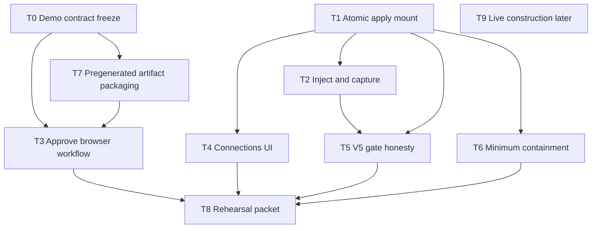

# Demo remaining work — pregenerated connector + AI-off sync

**Date:** November 10, 2026  
**Status:** Shared coordination doc for remaining product work. Not acceptance evidence, not a path reservation, and not an implementation plan for any single task.
**Audience:** Integrator and later delegated agents.

### How agents should use this file

This is the **shared remaining-work board** for the active demo track. Cold-start agents should find it from root [`README.md`](../../../README.md), root [`AGENTS.md`](../../../AGENTS.md) (“Read before changing behavior”), the current [November 10 team handoff](../../progress/2026-11-10/team-handoff.md), the [team expansion handoff](2026-11-08-team-expansion-handoff.md) reading order, and the [progress checkpoint](../../progress/2026-11-08/README.md) latest blurb.

When the integrator dispatches a T0–T9 task, or a task finishes / is blocked / is deferred:

1. Update the matching task’s status notes in §4 (owner, base/candidate SHA if known, blocked-on, done/partial).
2. Keep §2 “what already exists” current when a capability materially changes.
3. Do **not** treat this file as path/DDL reservation or joint acceptance; record those in the task handoff, review, and progress checkpoint as usual.

## 1. Demo strategy (locked for this track)

We will **not** require on-stage live model construction for the primary demo.

1. **Pregenerate or otherwise construct** the connector offline (operator-pinned fixture candidate and/or a separately recorded live/scripted build).
2. Label construction truthfully in the UI and evidence packet (`fixture` or captured-run), never as live-on-the-spot generation if it was not.
3. Show the product thesis on stage as: **review → explicit customer activate → inject a new conforming source record → deterministic worker sync with AI disabled**.

This keeps the PRD operating half of the thesis ([`prdv2.md`](../../../prdv2.md) §§1, 17, 19; playbook G5) while treating live G4 construction as optional follow-on evidence, not a demo blocker.

**Out of scope for this track unless explicitly reopened:** live OpenAI-backed construction in the default composition, Gate J acceptance as a demo prerequisite, V8 repair/reapproval, production auth, real ERP writes, bidirectional sync.

## 2. What already exists (do not rebuild)

| Capability | Status | Notes |
| --- | --- | --- |
| V0 foundation | Machine gate passing | Isolated control/runtime PostgreSQL, health, durable activity |
| V1 source evidence | Machine gate passing | Two synthetic acquisitions, dossiers, citations, captures |
| V2 preview + independent checks | Machine gate passing | Fixture connectors, protected evaluator, empty-target preview, zero parent writes |
| Discovery scaffolding | Partial | Lifecycle/delegation, monitor, findings/proposals, compilation/replay paths; default composition has **no model client** |
| Activation backend | Partial / not V3-accepted | Review prep, durable intents, worker first import/receipt recovery, package-detail reads |
| Sync capture | Partial | Internal API/semantic capture accepted in reviews; unmounted for product demo; CSV lanes rejected |
| Sync classification / selection | Partial | Compiler classification and four pure selector tasks are accepted. Catalog `74cd969` passes focused checks and independent spec/quality review; no substantial safe immediate simplification was identified. General capture/history inspection is follow-on, not a prerequisite silently added to the single-customer demo. |
| Atomic apply | Worker-private trigger mounted by PR56; exact T0 operator chain remains | Accepted P1 writer reused by `POST /internal/apply`, merged at `49245de`. Focused upstream proof uses in-process source observe/capture and returns `no_work` on second trigger; no full T2/V5/V6 acceptance. |
| Authority head / trusted ingress | Implemented and independently reviewed; demo/browser proof separate | P3 source `d8e2833` and its final review pass. PR54 merged the accepted authority ingress into main at `7de9366`; browser acceptance remains separate. |

Authoritative status claims also live in root [`AGENTS.md`](../../../AGENTS.md), [`docs/progress/2026-11-08/README.md`](../../progress/2026-11-08/README.md), and the [team expansion handoff](2026-11-08-team-expansion-handoff.md). Prefer those for exact SHAs and review links.

## 3. End-state demo walkthrough (acceptance target for this track)

The frozen script, Company A identities, integer-cent expectations, construction-mode labels, injection params, and per-step pass/fail observations live in the [demo contract](../../demo/demo-contract.md). Do not restage from this section alone.

A successful demo rehearsal for this track proves that contract: inspect sources; review a **pregenerated** `fixture` / `development-fixture` connector (never unlabeled live); **Approve this customer only** for Company A; keep the model client off; inject the specified post-cutover $300 payment; apply once (80000 → 50000 current, cutover asOf still 80000); replay with one economic effect. Company B and an extra invoice beat are optional stretch, not the primary script.

Optional stretch (not required to call the track demo-ready): schema-drift pause with peer continuity; second company enrollment; labeled captured-run replay in the Discovery UI.

## 4. High-level tasks for later delegation

Each task is intentionally coarse. Before dispatch, the integrator must freeze owned paths, migration numbers, exact base SHA, and whether the task is design-only, implementation, gate repair, or UI. Agents must not start dependent work from this list alone.

Suggested lane tags: **Platform** (runtime/authority/contracts), **Experience** (reviewer/ops UI + browser proof), **Discovery** (offline construction packaging only for this track), **Integrator** (composition, gates, rehearsal).

### T0 — Integrator: freeze the demo contract

**Status:** delivered and merged into main in PR55 at `fc79e94`; documentation-only T0 freeze. Demo implementation and acceptance remain separate.
**Lane:** Integrator  
**Depends on:** none  
**Outcome:** Written demo script + labeled modes (`fixture` vs `captured-run` vs later `live`) + exact customer/account IDs + expected cents for cutover and post-sync balances.  
**Done when:** One page lists the staged clicks, injection method, and pass/fail observations; no ambiguity about claiming live construction.  
**Delivered:** [demo contract](../../demo/demo-contract.md). Open decisions recorded there (optional invoice beat, Company B stretch, injection transport mounting) do not unfreeze identities, cents, or construction labels. T7 labeling is frozen there: current demo is `fixture` / catalog `development-fixture`.  
**Not in scope:** Implementing sync or UI.

### T1 — Platform: mount post-activation apply for one authorized customer

**Status:** worker-private `POST /internal/apply` merged in PR56 at `49245de`; existing P1 is reused. Upstream focused proof shows 80000→50000, preserved cutover and second-trigger `no_work`, with in-process observe/capture and non-T0 fixture seed; exact frozen operator chain and receipt recovery remain T2/T6 work. Platform continuation `codex/platform-company-a-demo-mount` integrated PR56 before implementation: Fresh Astra reconciliation retains only T2 fixed capture/receipt recovery; Sol Task 1 candidate `98bcc46` adds fixed T2 capture/recovery using the existing fixture; fresh Astra specification, quality and scoped verification review passes with no findings. Generic mount remains unchanged. No general selector/journal prerequisite or full V5/V6 claim.
**Lane:** Platform  
**Depends on:** accepted activation grant (A5 import), classification pin, current-authority fence, capture inbox facts for the chosen transport  
**Outcome:** Worker can take already-captured conforming deliveries for one enrolled customer and atomically apply a nonempty financial unit with an authoritative sync receipt, without model calls.  
**Done when:** Focused integration proof shows new money applied once, replay returns the same economic effect, cutover balance preserved, AI-off/worker isolation evidence labeled partial or full as appropriate.  
**Not in scope:** Scheduler polish, Connections UI, CSV if unsupported by capture, Gate J, live construction.  
**Pointers:** [atomic apply design](../../progress/2026-11-08/handoffs/platform-sync-atomic-apply-design.md), [classification plan](2026-11-09-sync-classification.md), [capture plan](2026-11-09-sync-capture.md).

### T2 — Platform: post-activation injection + capture path for the demo event

**Status:** Task 1 candidate `98bcc46` (base `f860564`) passes typecheck, 698 unit tests, 12 exact Company A integrations and 10 fixture/mount compatibility cases; independent review passes with independent5 unit/2 integration reruns. Task 2 private HTTP candidate `0c3bcaf` passes typecheck,701 units and3 real HTTP/PG integrations; fresh Astra review is running. Supervisor/CLI remain unmounted. Exact Company A event is frozen by T0; fixed operator HTTP transport and owned paths are specified by the bounded plan; transport implementation waits for Task 1 acceptance. No implementation acceptance yet.
**Lane:** Platform (sources/worker composition as reserved)  
**Depends on:** T1 or a jointly agreed temporary harness seam owned by Integrator  
**Outcome:** A controlled way to introduce one new Company A API (and optionally later Company B) event after activation and durably capture it into the inbox the applier consumes.  
**Done when:** Inject → capture → apply chain works in an isolated test without `FEATURE_NOT_IMPLEMENTED` stubs pretending to be the proof.  
**Not in scope:** General source productization or live agent tools.

### T3 — Experience: finish Approve-and-enable browser workflow

**Status:** partial — backend and existing browser work are available; exact remaining browser scenarios/public packet remain Experience-owned. Existing delivered reviewer/authority follow-ups still apply.
**Lane:** Experience  
**Depends on:** activation backend already mounted; Integrator gate/parser fixes if still open  
**Outcome:** Reviewer can prepare, inspect package details/evidence, approve one customer, and see parent import + receipt without inventing authority in the UI.  
**Done when:** Browser scenarios cover approve, replay/idempotent second click, and rejection of stale/unauthorized attempts; V3 packet retains run-specific public evidence.  
**Not in scope:** Inventing financial rules; claiming V3 joint acceptance without Integrator gate pass.  
**Pointers:** [activation review setup](../../demo/activation-review-setup.md), [worker activation setup](../../demo/worker-activation-setup.md), V3 review findings under `docs/progress/2026-11-08/reviews/`.

### T4 — Experience: Connections / sync observation surface

**Status:** partial — existing operations surface and reviewed authority API are prerequisites. Shared-lane visibility, honest unmeasured runtime-model metric, explicit authority-action refresh and demo observation proof remain Experience-owned.
**Lane:** Experience  
**Depends on:** T1 progress reads / receipts (design freeze with Platform first)  
**Outcome:** Demo-visible connection state: active customer, pinned artifact, last receipt, applied vs held/gap counts, and clear AI-off posture.  
**Done when:** UI shows worker-authored facts only; no UI-computed balances or inferred authorization.  
**Not in scope:** Pause/revoke command UX beyond what Platform exposes; repair flows.

### T5 — Integrator: make V5 machine gate prove ongoing application

**Status:** not started
**Lane:** Integrator  
**Depends on:** T1 + T2 minimum proofs  
**Outcome:** `verify:slice -- V5` cannot pass on capture/authority/health alone; mandatory observations include fresh conforming apply, updated money, preserved cutover, and receipt.  
**Done when:** Gate fails closed without apply proof; passes only with the required named cases.  
**Pointers:** [V5/V6 gate review](../../progress/2026-11-08/reviews/platform-v5-v6-gate-9866847-review.md).

### T6 — Platform: minimum containment for the demo path

**Status:** partial — accepted P1 storage/writer/race cases provide backend evidence; the chosen mounted demo still needs its own replay/crash/out-of-scope observations. Broader cross-stream and dependency-release proofs remain follow-on.
**Lane:** Platform  
**Depends on:** T1  
**Outcome:** Enough V6 behavior that the demo (and gate) can show: exact delivery replay is harmless; crash/retry around apply does not double-count; unknown/out-of-scope input does not corrupt enrolled money.  
**Done when:** Focused tests cover those three; schema-drift peer-continuity and payment-before-invoice release may remain stretch unless pulled into the demo script by T0.  
**Not in scope:** Full G6 matrix or V8 repair.

### T7 — Discovery (optional for this track): package a truthful pregenerated artifact

**Status:** partial — real operator-pinned A/B fixture construction already exists and is qualified. T0 must choose the exact package/labels; reuse it instead of rebuilding live construction. This remains optional Discovery packaging work for this track.
**Lane:** Discovery  
**Depends on:** T0 labeling decision — frozen in the [demo contract](../../demo/demo-contract.md): current demo is `fixture` / catalog `development-fixture`; captured-run only if labeled; live is T9.  
**Outcome:** One clearly labeled artifact/profile package (fixture pin and/or offline generated candidate) mounted for review/activation, with instructions so the demo never implies live construction.  
**Done when:** Operator setup doc + hashes; Discovery UI can show a captured-run replay **only if labeled**.  
**Not in scope:** Default live model client, Gate J acceptance, holdout live builds (separate later track).

### T8 — Experience + Integrator: two-company or single-company rehearsal packet

**Status:** not started
**Lane:** Experience leads; Integrator records  
**Depends on:** T3 + T1–T5; T6 for replay beat  
**Outcome:** One rehearsable runbook and evidence packet for the hackathon-style walkthrough in §3. Prefer one Company A happy path first; add Company B only when CSV/file capture apply is actually available.  
**Done when:** Three timed rehearsals recorded or explicitly waived by the user; limitations section states fixture/pregenerated construction and any missing containment.

### T9 — Later track (explicitly deferred): genuine live construction

**Status:** deferred
**Lane:** Discovery + Integrator  
**Depends on:** user-configured model key; Gate J corrections; live holdouts  
**Outcome:** G4/V4 acceptance with real provider evidence and independently checked A/B builds.  
**Done when:** Playbook G4 pass evidence exists.  
**Not required** to ship the §3 demo track.

## 5. Suggested dependency order

Parallelism that is usually safe after T0:

- Experience can advance T3 while Platform advances T1/T2.
- T7 packaging can proceed in parallel with Platform apply work.
- T4 should wait for a short Platform↔Experience read-model freeze so the UI does not invent progress fields.
- T5/T8 stay Integrator-owned and should not be “passed” by partial prerequisite suites.

## 6. Non-negotiables for every delegated task

- Keep evidence, interpretations, approvals, and imported records distinct.
- Preview and discovery write zero parent money; only explicit per-customer approval grants standing sync authority; worker receipts are authoritative.
- Runtime has no model SDK/key; control and runtime databases stay isolated.
- Machine checks ≠ independent review ≠ joint user acceptance.
- Fixture/pregenerated mode must be labeled; do not present hardcoded company mappings as live agent discoveries ([`prdv2.md`](../../../prdv2.md) §6 / §18).
- Implement only reserved paths for the dispatched task; raise specification gaps instead of inventing financial behavior.

## 7. Related documents

- [Demo contract](../../demo/demo-contract.md) — frozen T0 identities, modes, cents, injection, and pass/fail
- [PRD v2](../../../prdv2.md) — thesis, demo walkthrough, acceptance criteria
- [Implementation plan](2026-11-08-implementation-plan.md) — original V0–V8 slices
- [Verification playbook](2026-11-08-verification-playbook.md) — G0–G7 gates
- [Team expansion handoff](2026-11-08-team-expansion-handoff.md) — lane ownership and older dependency graph
- [Progress checkpoint](../../progress/2026-11-08/README.md) — historical integration status
- Demo setup guides under [`docs/demo/`](../../demo/)

## 8. Current integrator checkpoint and preserved follow-on work

PR54 merged at `7de9366c8543ba4ae9c455006e55c70af16e33fd`; its complete tree equals reviewed continuation head `01bc534`. PR55/T0 is already merged. On November 10 the integrator checked the clean designated worktree and pulled main (already current), then created `codex/platform-company-a-demo-mount`. The original demo checkout and database remain preserved.

Fresh Astra design and independent review freeze the narrow T1/T2 mount; required receipt recovery corrections are incorporated. Integrator owns board/coordination documents; PR56 is integrated; the sole Sol Task 1 writer resumes the revised T2 scope and isolated test lease after fresh Astra reconciliation. Once design and paths are frozen, one Sol implementer will own the source and isolated tests, followed by fresh Astra exact-candidate review. Latest inspected CI runs `42873005041`, `42872902546`, and `42872595578` report startup failure; no green CI claim is made.

General multi-customer capture/history selection, dependency journal/application scheduling, Discovery Gate J/live construction, and the explicit proposed-scope grant workflow remain preserved follow-on work, with their accepted designs/reviews and unresolved owner contracts. They are not new blocking requirements for this board's one-customer pregenerated AI-off demo. The user's explicit read/verification grant decision remains binding if that workflow is later implemented; no automatic grant is permitted. See [Platform coordination](../../progress/2026-11-10/platform-coordination.md) for exact source ownership, reviews, policy decision and delivered requests.
