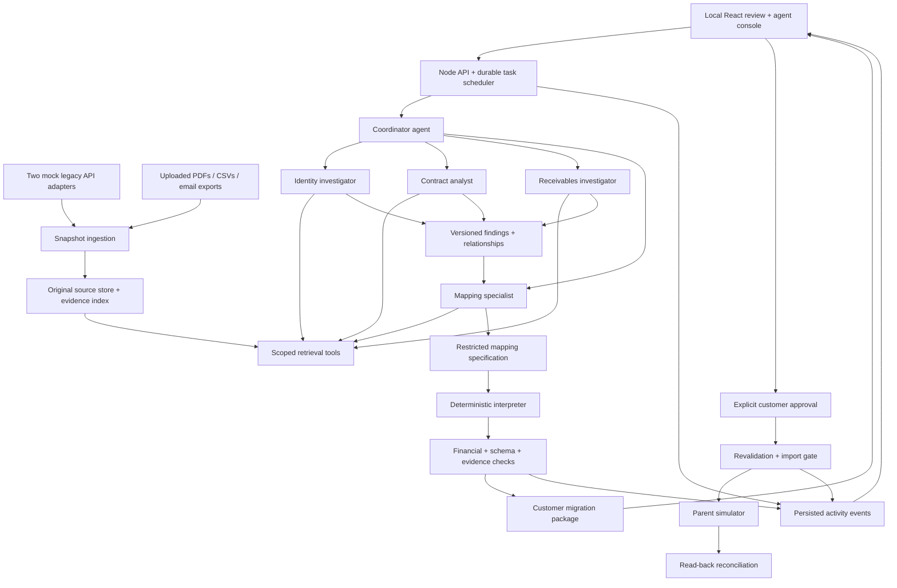
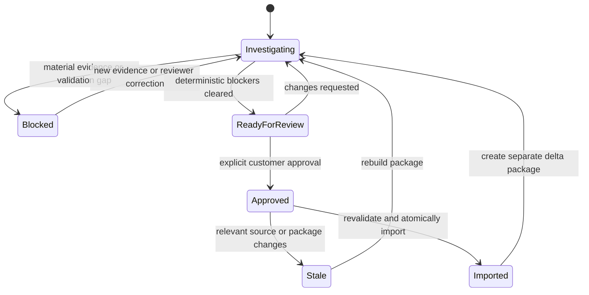
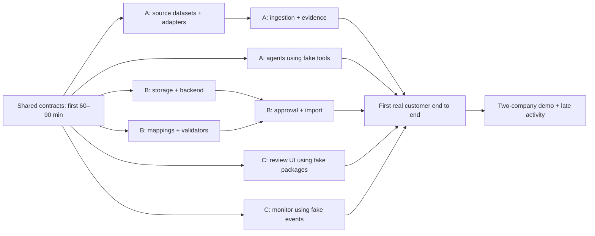

# Acquisition Financial Translation — PRD and Architecture

**Status:** Draft for review; product code has not been started.

**Date:** November 7, 2026

**Delivery:** 2–3 days, three developers, each using a team of coding agents.

**Workspace:** `/Users/devincheng/Documents/EnterpriseAgenticPaymentResolution`

## 1. Product definition

Translate an acquired company's fragmented contract-to-cash records and business rules into the parent company's predefined financial model, preserving their relationships, financial meaning, evidence, and legacy references.

The parent finance team should be able to answer: **What are we importing, why is this translation supported, what remains unresolved, and does the imported history reconcile?**

This is a migration and integration workbench. It does not issue new invoices, collect money, arbitrate disputes, or operate a new billing business. It translates existing invoices and billing configuration so the parent can continue operating its own systems. The prototype demonstrates this with a simulated parent system.

### Confirmed decisions

- Two acquired companies with different legacy formats, feeding one predefined parent schema.
- Both uploaded files and simulated legacy APIs.
- Generated synthetic source data and a live demo.
- Autonomous collaborating product agents, visible in a monitoring interface.
- Deterministic tools for financial integrity and controlled execution.
- Explicit human approval for each customer's migration package; no bulk approval.
- TypeScript/Node.js application, running locally.
- Three developers working concurrently with their own coding-agent teams.
- A 2–3 day build window.

### Proposed defaults to review

- Two B2B service businesses, six customer accounts each, three months of history, fixed monthly contracts, USD only.
- React/Vite, Fastify, SQLite, Zod, and direct OpenAI tool calling; specific dependency versions pinned during setup.
- OpenAI is the first model provider. Claude can be substituted through a narrow adapter; implementing two providers is not required.
- One local demo reviewer identity. This demonstrates approval semantics, not enterprise authentication.
- Reviewers can select evidence-backed alternatives or add a correction with rationale and evidence, then rerun validation.
- One approval unit is a **customer account within an acquired legal entity**. The same buyer served by both acquisitions has two separately reviewed packages.
- Approval enables a separate explicit Import action. It does not immediately write to the parent.
- A blocked customer does not prevent other independently validated customers from migrating.
- Reversals support full payment or credit reversals only; partial reversals and invoice cancellations are held as unsupported.

These defaults are design proposals, not additional decisions attributed to the user.

## 2. Users, problem, and success

**Buyer hypothesis:** CFO/controller at a serial acquirer of B2B service businesses.

**Primary user:** Finance integration lead.

**Supporting users:** Billing and accounts-receivable analysts.

Legacy records can be syntactically imported yet lose their meaning: aliases split one customer, invoices lose payment relationships, amendments disappear, and recurring charges are transferred with the wrong effective dates. The product reconstructs those relationships before approving a translation.

The demo succeeds when a reviewer can:

1. Load two differently structured acquisitions.
2. Watch agents investigate records, retrieve evidence, and collaborate.
3. Inspect a proposed customer package with field-level provenance and reconciled balances.
4. Correct or hold an ambiguous package without hiding the uncertainty.
5. Explicitly approve and import one customer's exact package into the parent simulator.
6. Inspect equivalent parent records and preserved legacy references.
7. Handle a late legacy payment through a separately reviewed delta, without duplicate records or allocations.

Claims about buyer demand, competitive differentiation, time savings, and willingness to pay remain hypotheses. A synthetic demo does not validate them.

## 3. Scope and exclusions

### Required

- API discovery through supplied schema metadata and bounded record queries.
- CSV and text-based PDF ingestion; a simple JSON email-thread export.
- Source snapshots, page/row/JSON-pointer citations, and explicit ingestion failures.
- Customer identity proposals that preserve legal entities and account boundaries.
- Contract and amendment extraction with applicability and effective dates.
- Existing invoice, payment, credit, reversal, and allocation relationships.
- Historical and cutover receivables checks within the supplied history window.
- Translation of supported fixed recurring billing configuration.
- Restricted, reusable source-to-target mapping rules and a deterministic interpreter.
- Agent task coordination, structured findings, bounded investigation, live events, and pause/resume.
- Per-customer review, approval invalidation, idempotent import, and late-activity handling.
- A separate evaluator with hidden synthetic truth; deterministic and adversarial checks.

### Excluded

- New invoice issuance, actual payments, bank rails, collections, and negotiation.
- Production ERP connectors, enterprise SSO, multi-tenant deployment, and production accounting certification.
- Revenue recognition, tax calculation, FX, usage billing, proration, consolidated reporting, purchase accounting, or legal contract assignment.
- Automated legal determination that an acquisition transfers a contract or receivable to a different entity.
- Model training/fine-tuning, arbitrary code generated and executed by agents, web browsing by product agents, or unrestricted SQL/shell tools.
- Scanned-document OCR, live Gmail/Slack connections, and arbitrary spreadsheet workbooks. Demo spreadsheets are CSV exports; emails are files.
- Automatic correction of historical accounting discrepancies or approval of inferred material terms.

### Failure conditions

The demo fails if it silently fabricates a transaction, merges separate legal entities, treats an email assertion as a binding amendment without sufficient evidence, duplicates imported receivables, hides unresolved financial differences, or imports without the required customer approval.

## 4. Synthetic acquisition scenario

The parent is a fictional B2B services group. Acquisition does not itself change the legal owner of the records: the parent simulator preserves the acquired seller entities as separate operating entities.

| Dimension | Company A — structured legacy | Company B — fragmented operations |
|---|---|---|
| Business | Managed IT services | Recurring facilities services |
| Primary input | Mock REST API with stable customer IDs | Uploaded customer and transaction CSVs |
| Contracts | PDFs linked by legacy customer ID | PDFs, separate amendments, email exports |
| Supplemental input | Contract/amendment upload | Mock receipt API with weak remittance references |
| Billing representation | Explicit schedule records | Contract terms and corroborating historical invoices |
| Challenge | Different field names, units, enums, and foreign keys | Aliases, ambiguous relationships, missing or conflicting evidence |

Proposed fixture size: 12 source customer accounts, around 36 invoices, associated payments/credits, and about 16 short PDFs. Keep the full portfolio inspectable; use three featured cases during the presentation. At least one customer appears in both acquisitions, but its seller accounts and receivables stay separate.

Use an explicit synthetic cutover timestamp, such as `2026-10-01T00:00:00Z`. Financial effective dates and source observation timestamps are separate. These are fixture dates, not claims about actual businesses.

### Generate truth before generating disorder

1. Define canonical entities, signed contract terms, transactions, allocations, and expected target results using a seeded TypeScript fixture generator.
2. Compute expected balances with an independent reference calculation and hand-check featured examples.
3. Render company-specific APIs, CSVs, PDFs, and email exports from that history.
4. Apply a recorded set of distortions: aliases, dropped references, date formatting changes, inconsistent field labels, and duplicated exports.
5. Maintain a separate **observable-evidence manifest**: which facts are provable from the exposed sources, which are ambiguous, and which must remain unresolved. Omniscient truth alone must not penalize correct abstention.
6. Keep truth and distortion manifests outside the agent tool namespace, served files, and application retrieval index. The evaluator receives them; runtime agents do not.

An LLM may help phrase synthetic documents, but must not decide the monetary ground truth or alter seeded facts. The minimal implementation can use templates for all source documents.

### Featured cases

| Case | Visible problem | Expected behavior |
|---|---|---|
| A1 — straightforward | Different source schema; invoice $3,000, allocated payment $2,000, allocated credit $200 | Map relationships; show $800 open; await customer approval before importing |
| A2 — amendment | Base recurring fee $1,000; executed amendment sets $1,200 effective September 1; legacy setting still says $1,000 | Preserve both source observations; propose effective-dated $1,200 configuration with amendment evidence; surface historical underbilling without inventing an invoice or adjustment |
| B1 — ambiguous remittance | Two plausible customers, similar names and equal invoice amounts; payment reference missing | Leave payment unallocated and relevant packages blocked until additional remittance evidence is supplied |
| B2 — legal-entity collision | Similar customer names, distinct legal identifiers | Do not merge legal entities based on name similarity |
| B3 — unsupported term | Email mentions a discount but the governing amendment is absent | Flag missing evidence; do not populate a confirmed discount |
| Late activity | $300 legacy payment for A1 is effective October 2 and discovered October 3, after the October 1 cutover/import | Propose a delta yielding $500 as of October 3; retain $800 as of cutover; obtain fresh approval; duplicate replay changes nothing |

For B1, the demo has a separate operator-controlled action that adds a remittance document to the source bundle. The operator controls scenario injection; agents cannot call this action or fetch its hidden document early.

## 5. Review and monitoring experience

### Acquisition overview

Show source coverage, customer counts, accounts ready for review, blocked accounts, approved accounts, imported accounts, and unmapped/unassigned source records. Financial totals must disclose their coverage; an incomplete portfolio cannot be labeled fully reconciled.

### Agent operations console

- Agent role, current task, customer scope, status, dependencies, and elapsed time.
- Delegation events and structured messages between agents.
- Tool name, validated arguments, result summary, and links to evidence.
- Findings, contradictions, revisions, validation failures, and escalation reasons.
- Model-call counts, token usage, estimated cost, and remaining configured budgets.
- Pause and resume at tool boundaries, plus retry for failed read tasks.

Display concise explanations and observable actions, not hidden model chain-of-thought. A replay mode must be labeled Replay and use an actual captured run; do not animate fabricated activity as live execution.

### Customer review workspace

Use a three-part view: source records and evidence, proposed parent records/diff, and validations/exceptions. For every material field, show provenance classification, source reference or derivation, and any disagreement.

The reviewer can:

1. Inspect the record graph: customer → contract/version → invoice → payment/credit allocation.
2. Compare source and target field values and the transformation applied.
3. Open the cited PDF page, CSV row, API snapshot, or email message.
4. Choose an evidenced alternative or enter a correction with evidence and a reason.
5. Request another investigation, supply a missing file, or leave the customer on hold.
6. Approve the current eligible package for this customer only.
7. Import that approved package and inspect the parent result.

Human corrections are recorded as new reviewer-authored assertions with their own provenance; the original extraction and source record remain unchanged. Authorship and evidence class are separate: manually correcting a price to the exact value in a cited executed amendment has `origin=reviewer` and `provenanceClass=observed`, because the value is directly observed in that source. Typing a new price with no supporting document remains inferred/unresolved and cannot be approved. A reviewer cannot bypass arithmetic, referential-integrity, legal-entity, unsupported-material-term, or stale-version blockers through an override checkbox.

### Approval semantics

- Approval binds `packageId`, `packageVersion`, a canonical content hash, source snapshot revisions, mapping version, validator version, and an explicit reviewer action.
- Before approval, show record counts, outstanding balance, mapped billing configuration, warnings, and proposed changes.
- No “approve all.” Each customer account requires its own click.
- Changes to values, evidence, mappings, validations, or relevant source revisions invalidate approval.
- Rejection/hold is distinct from an agent failure.
- Approval and import are separate actions; import revalidates the exact package and relevant source revisions.
- New post-import activity creates a delta package, requiring its own customer approval. It does not edit the historical approval receipt.
- The local reviewer identity is a demo convention. It is not a production security boundary or legal signature.

## 6. Architecture and trust boundaries

### Four separate data layers

| Layer | Contents | Mutation rule |
|---|---|---|
| Source | Original bytes, API snapshots, source metadata | Append new versions; never overwrite originals |
| Interpretation | Extracted terms, hypotheses, relationships, mapping proposals | Append/supersede versions; retain disagreement |
| Review | Validations, reviewer corrections, package versions, approvals | Append decisions; bind approvals to exact versions |
| Parent | Imported target records and import receipts | Only controlled import service can write |

The prototype uses one SQLite database with separate table groups and a local evidence directory. Agents never receive database credentials, arbitrary filesystem access, or a parent write tool. Application repositories enforce layer boundaries. This is appropriate for a single local trusted demo, not isolation against a malicious local administrator.

### Local runtime

- A React/Vite frontend and one Fastify backend; mock legacy API routes and the parent simulator are modules of the backend.
- One backend process owns database writes. Short SQLite transactions serialize mutations; concurrent model calls do not hold database transactions open.
- A persistent task table acts as the small job queue. No Redis, message broker, separate microservices, or graph database is needed for this scope.
- Server-sent events deliver persisted events to the browser. Reconnect with a monotonic event cursor; fetching state does not restart a run.
- On backend restart, unfinished model/tool tasks become interrupted and can be retried. Durable findings and approvals survive; exact continuation inside a model request is not promised.
- Bind to localhost; secrets stay in backend environment variables, excluded from logs and source control.

## 7. Autonomous agent workflow

The autonomy lies in choosing investigations, queries, task assignments, and proposed interpretations. Persisted application state and deterministic controls constrain the results. Product agents are distinct from developers' coding agents.

| Agent | Decisions it owns | Important restrictions |
|---|---|---|
| Coordinator | Select tasks, delegate, reconcile conflicting findings, request follow-up, escalate | Cannot declare its own proposal approved or bypass a validator |
| Identity investigator | Propose aliases, account links, buyer identity relationships | Similarity alone cannot merge legal entities or accounts |
| Contract analyst | Extract terms, compare amendments, identify applicable effective intervals | Material ambiguity or missing authority remains unresolved |
| Receivables investigator | Propose allocations and links; explain differences | Cannot manufacture payments, credits, invoices, or balancing entries |
| Mapping specialist | Propose source fields, lookup relationships, transformations, and target structure | Can emit only the allowed mapping language, not executable code |

### Run behavior

1. Deterministic ingestion captures the selected source snapshot and reports coverage/errors.
2. Coordinator examines source catalogs and target schema; creates a bounded task dependency graph.
3. Identity and contract investigations can begin concurrently. Receivables tasks can inspect records immediately but must resolve material identity dependencies before final allocation proposals.
4. Specialists publish structured findings and explicit requests to other roles through the coordinator. The runtime validates recipients, scope, and task budgets.
5. Mapping specialist proposes schema rules early, then refines customer-specific translations as findings arrive.
6. Interpreter produces target candidates; validators return structured results, never a vague “looks good.”
7. Coordinator can delegate a focused repair investigation. Repeated failure or exhausted budgets creates a review exception.
8. Once blockers are cleared, application state marks the package ready for human review. Agents do not decide approval eligibility by themselves.
9. Human approval and a separate import action trigger deterministic revalidation, import, and read-back checks.

This is a dynamically selected task graph within bounded capabilities, not a fixed script that merely narrates precomputed results. Model variability is expected; the fixture answer key is used only to evaluate output.

### Collaboration and concurrency controls

- The coordinator is the only role allowed to create specialist tasks. Specialists can request delegation; they cannot recursively spawn unbounded agents.
- Suggested limits: four simultaneous model calls globally, ten specialist tasks per customer package, eight tool rounds per task, and two focused repair rounds per package.
- Requests have explicit input/output-token caps and timeouts. Reserve estimated usage before scheduling concurrent calls; stop launching calls when the configured allowance is exhausted. Report actual provider usage when returned.
- A cost ceiling is an application estimate with a reserve for in-flight calls, not a promise of an exact provider-dollar hard cap. Configure provider-side limits where available.
- Deduplicate tasks by scope, question, and evidence revision. Reject cyclic dependencies.
- Findings carry an expected revision. Concurrent updates cannot silently replace a newer finding; conflicting proposals coexist until resolved.
- Scope is inherited from the runtime's task identity, not trusted from agent-written company IDs. Cross-acquisition identity investigation gets a separately allowed combined scope.
- Source text and tool results are untrusted content. They cannot register new tools, change policies, access hidden fixture truth, or authorize imports.

### Package lifecycle

The last transition creates a new delta package; the original imported package and its receipt remain immutable. Task states separately include queued, running, waiting, succeeded, failed, paused, and interrupted.

## 8. Deterministic tool contracts

All tools validate input/output schemas, enforce runtime scope, return typed errors, and emit activity events. Tool output is data, not new system instructions.

| Tool/service | Input → result | Authority |
|---|---|---|
| `describeSource` | Approved source ID → schemas, units, enums, pagination, revision capabilities | Agent read |
| `querySource` | Source, allowed filters, fields, cursor → versioned records | Agent read; bounded query, no raw SQL |
| `searchEvidence` | Scope, query, filters → source excerpts and citation IDs | Agent read |
| `readEvidence` | Citation/snapshot ID → exact page, row, or JSON field and metadata | Agent read |
| `publishFinding` | Structured claim, alternatives, citations, expected revision → finding version | Agent proposal only |
| `proposeMapping` | Mapping document and expected version → validated draft | Agent proposal only |
| `previewTranslation` | Mapping + snapshot + customer scope → target candidates and field lineage | Agent read/derived output |
| `validatePackage` | Candidate package version → checks, blockers, warnings, control totals | Agent/reviewer callable; cannot approve |
| `computeReceivables` | Evidenced transactions, allocations, as-of date → balances and breakdown | Deterministic arithmetic |
| `approvePackage` | Package/version/hash + reviewer action → approval receipt | Reviewer route only |
| `importPackage` | Approved package + idempotency key → imported IDs and receipt | Reviewer invokes; application executes |
| `reconcileImport` | Import receipt → expected versus actual records/totals | Deterministic read-back |

Scenario injection and reset routes are demo-operator controls and are not included in any agent tool registry.

### Mapping language

Supported operations: select field, approved constant, explicit date parse, decimal-to-minor-unit conversion, enum lookup, trim/case normalization for matching, ID lookup, join on approved identity relationships, and selection of confirmed effective-dated terms.

Every operation declares its inputs and output type. A constant can encode a known source currency or seller entity; it cannot fill an unknown price or missing transaction. Mapping operations propagate field lineage. Dates with ambiguous formats, unknown enum values, unsupported rules, and unmatched required foreign keys produce explicit errors.

No arbitrary JavaScript, `eval`, SQL, shell, or expressions with general-purpose execution. Keep the interpreter small and versioned.

### Core validation rules

- Integer minor units within supported safe numeric bounds; one explicit currency; no floating-point monetary arithmetic.
- Preserve source totals. Invoice line totals must reconcile to the source invoice total; the prototype fixtures exclude taxes and proration.
- Allocations must reference an existing eligible invoice/payment/credit and cannot exceed the available amount or invoice balance under the supported rules.
- Payment allocations stay within the same seller entity, customer account, and currency. Credits reduce receivables only through explicit applicable allocations.
- Reversals reference an existing payment or credit and negate its full amount and all of its allocations as one effective-dated operation; original transactions and allocations remain recorded. Only one full reversal per original is allowed. Partial, allocation-specific, invoice, and reversal-of-reversal operations are unsupported and held. Agents cannot synthesize reversal records from unexplained differences.
- In-scope invoice balance at date `t` = effective invoice amount minus effective allocated payments and allocated credits, with reversal effects accounted for. Unallocated cash is reported separately.
- Contract terms have explicit effective intervals. Unresolved overlapping versions block affected configuration.
- Field evidence must resolve to the captured source version. A resolving citation proves provenance, not that a model interpreted the text correctly.
- Critical interpreted terms require visible reviewer inspection and approval. Model agreement or confidence cannot establish truth.
- Required monetary amounts and binding contract terms must be directly observed in applicable evidence or deterministically derived from confirmed inputs. Reviewer confirmation alone cannot promote an unsupported value. Identity and schema-mapping relationships may remain classified as inferred if the reviewer explicitly confirms the relationship, cites supporting evidence, and all applicable identity/entity/type checks pass; this is a visible human judgment, not a claim of observed fact. Unresolved or contradicted required relationships remain blockers. Optional unsupported descriptive fields may remain null with an explicit warning.
- The full source manifest is reconciled: every in-scope transaction is mapped once, held with a reason, or intentionally excluded with a reason. Orphans and duplicates cannot disappear from totals.
- Complete-history imports and opening-balance snapshots cannot both contribute monetary entries. The prototype imports supported detailed history; opening/cutover balances are derived control values, not extra posted transactions.

Historical results are only claimed for the supplied complete history window. Sources must include enough opening detail to support that window; otherwise the affected customer is blocked. Do not infer missing opening transactions.

## 9. Data model and shared contracts

### Parent simulator entities

| Entity | Key contents |
|---|---|
| `LegalEntity` | Legal identifier, name, role; acquired sellers remain distinguishable |
| `Customer` | Canonical buyer identity; shared identity does not pool receivables |
| `CustomerAccount` | Buyer + acquired seller relationship, legacy account references |
| `Contract` / `ContractVersion` | Parties, source agreement, confirmed terms, effective interval |
| `BillingConfiguration` | Contract version, fixed fee, currency, cadence, anchor, next scheduled date, status |
| `Invoice` | Legacy invoice reference, account, issue/due/service dates, existing amount |
| `Payment` / `Credit` | Source transaction identity, account, effective date, amount |
| `Allocation` / `Reversal` | Referenced transactions, amount, effective date, provenance |
| `LegacyReference` | Source system + entity + source ID → parent ID |
| `ImportReceipt` | Package hash, imported IDs, per-record action, source revisions, reconciliation result |

The simulator exposes target records, relationships, billing configuration, and derived balances. It has no “issue invoice” action. Amounts from contracts are configuration, not automatically recognized revenue or receivables.

### Workbench contracts to freeze together before parallel development

| Contract | Required fields/semantics |
|---|---|
| `SourceSnapshot` | ID, acquisition/entity scope, source ID, source revision, captured time, financial coverage window, content hash, record/byte location |
| `EvidenceRef` | Snapshot ID, source record/message ID, PDF page / CSV row+column / JSON pointer, excerpt, source authored time if known |
| `Finding` | ID, task/scope, subject+field, proposed value, origin, provenance class, evidence status, review disposition, citations or derivation inputs, alternatives, revision |
| `MappingSpec` | ID/version, source and target schema versions, operations, joins, required inputs, output types |
| `ValidationResult` | Stable rule ID/version, pass/fail/unknown, blocker/warning, affected fields/records, evidence refs, expected/actual values |
| `MigrationPackage` | ID/version, customer account scope, kind initial/delta, snapshot manifest, mappings, target candidates, lineage, validations, content hash, status |
| `Approval` | Package ID/version/hash, reviewer ID, timestamp, source/mapping/validator versions |
| `Task` | Run ID, role, scope, question, dependency IDs, input revision, status, budget, attempt |
| `ActivityEvent` | Monotonic sequence, time, run/task/agent/scope, event type, structured payload, correlation ID |

Provenance class is `observed | derived | inferred | unresolved`. Origin is `agent | deterministic | reviewer`; evidence status is `supported | contradicted | insufficient`; review disposition is `pending | confirmed | rejected`. These are separate from package workflow status. Derived values include arithmetic inputs and calculation version. A reviewed inference retains its inferred classification. The reviewer records evidence-backed confirmation; that action does not turn uncertain contract language into authoritative terms. No single confidence percentage replaces these distinctions.

Stable source identity is namespaced by acquisition/source/entity/type/legacy ID. For CSVs without IDs, use the versioned file and row as source identity and explicitly reconcile candidate duplicates; content hashes alone cannot establish business identity. Duplicate uploads of identical bytes reuse the same captured content rather than creating new transactions.

### Representative API surface

| Route | Purpose |
|---|---|
| `POST /sources/uploads` | Upload and snapshot a supported source |
| `GET /legacy/:company/schema` and resource routes | Mock source schema and records |
| `POST /runs` | Start a run against explicit source revisions |
| `GET /runs/:id/events?after=<sequence>` | SSE events with reconnect cursor |
| `POST /runs/:id/pause` / `resume` | Control scheduling at task/tool boundaries |
| `GET /customers/:accountId/package` | Current package, lineage, validations, status |
| `POST /packages/:id/corrections` | Versioned reviewer correction with evidence |
| `POST /packages/:id/approve` | Explicit approval with expected version/hash |
| `POST /packages/:id/import` | Revalidate and idempotently apply approved package |
| `GET /parent/customers/:accountId` | Imported records, configuration, and balances |

Write routes use expected versions and return conflicts for stale requests. Upload/source IDs and paths are controlled by the application; filenames or agent arguments cannot read arbitrary local files. Model credentials are never exposed in browser bundles.

## 10. Cutover, late activity, and idempotency

Cutover uses a financial effective timestamp plus a captured source revision. These serve different purposes: the effective timestamp determines financial inclusion; the revision tells us which records were observed. A backdated payment discovered later is retained with both dates.

For the featured late-payment case, the payment is effective October 2 and observed October 3. The original October 1 cutover balance remains $800; the updated balance as of October 3 becomes $500. Display both dates explicitly. A separate test covers a payment effective before cutover but observed afterward: a newly approved delta changes the latest reconstruction of the cutover balance, while the original package's historical snapshot and approval receipt remain unchanged. Historical queries therefore specify both financial `asOf` and the reconstruction/snapshot version.

For the demo, mock APIs provide monotonic revisions and change cursors. Files are immutable once uploaded; a replacement is a new snapshot. Before import, check the relevant source revision. A relevant change marks the package stale. The prototype does not claim an atomic distributed cutover against arbitrary live ERPs; it explicitly exercises the controlled source revision contract.

An import transaction:

1. Verifies package hash, approval, source revision, dependency versions, and current parent references.
2. Recomputes mandatory validations.
3. Writes the customer-scoped target records, provenance, import receipt, and activity event in one SQLite transaction.
4. Checks resulting references and control totals before commit; validation failure rolls back the transaction.
5. Makes read-back results visible in the UI.

The idempotency key is unique to the package version; source-reference uniqueness also prevents replay of the same source transaction under another package ID. Repeating the same successful request returns its receipt. A crash before commit leaves no partial import; a crash after commit is recovered by looking up that receipt.

After initial import, source changes create a separately versioned delta. The demo requires an additive late payment, not arbitrary destructive source edits. If an imported source transaction changes materially, flag it for review; do not silently overwrite the parent history. Ledger corrections outside supported additive/reversal rules are out of scope.

Shared customer identity changes are versioned dependencies. Once a parent customer exists, subsequent packages must reference its existing stable ID; a conflicting proposal is held for review. They cannot independently create duplicate canonical customers or mutate identity records relied on by an approved package.

## 11. Proposed technology choices

| Area | Choice | Reason / constraint |
|---|---|---|
| Language/workspace | TypeScript strict mode, npm workspaces | Shared runtime contracts across three developers |
| UI | React + Vite | Local interactive application; no server rendering requirement |
| API/runtime | Fastify on a supported Node LTS | One process for APIs, scheduler, and simulator modules |
| Validation | Zod shared schemas | Runtime validation plus inferred TypeScript types |
| Persistence | SQLite through a thin repository layer | Durable local state; short single-writer transactions |
| Files | Local immutable snapshots | Source inspection without external storage setup |
| PDF ingestion/display | PDF.js, page-aware text extraction | Text PDFs only; retain page references |
| Synthetic PDFs | pdf-lib | Deterministic documents generated from canonical fixtures |
| Agent calls | OpenAI SDK, tool calling, structured outputs where supported | Small provider boundary, explicit per-role tools |
| Coordination | Application-owned persistent tasks and events | Expose exactly the state required by review and monitoring |
| Live UI | SSE plus REST actions | One-way activity stream and explicit mutations |
| Tests | Vitest; Playwright for critical review/import flow | Validate money, concurrency, permissions, and real UI actions |

Version numbers, the SQLite driver, CSS component library, and exact model ID are builder choices. Pin compatible stable dependencies and record the chosen model/configuration in every run. Select the model through a short representative extraction/tool-call evaluation rather than an unverified “latest” alias.

Provider billing remains an environment prerequisite, not an implemented feature. Confirm claimed API credits and rate limits before live rehearsals. An application API key is distinct from developers' coding-agent subscriptions. Keys stay local and are not written into this document or fixtures.

Official references checked while proposing this stack: [Vite](https://vite.dev/guide/), [Fastify](https://fastify.dev/docs/latest/), [SQLite use cases](https://www.sqlite.org/whentouse.html), [Zod](https://zod.dev/), [PDF.js](https://mozilla.github.io/pdf.js/getting_started/), [pdf-lib](https://pdf-lib.js.org/), [OpenAI function calling](https://developers.openai.com/api/docs/guides/function-calling), [Vitest](https://vitest.dev/guide/), and [Playwright](https://playwright.dev/docs/intro).

### Approaches considered

1. **Fixed migration pipeline:** simplest to build, but less capable of choosing follow-up investigations. Not selected.
2. **Case-based investigation within a prescribed workflow:** a strong middle ground, originally recommended. Not selected by the user.
3. **Autonomous collaborating agents with deterministic tools:** selected by the user. Agents choose investigations and coordinate dynamically; application controls still own money calculations, approval, and imports.

The chosen design uses a bounded task scheduler because autonomy does not require separate services or unlimited delegation. A managed agent framework can replace the scheduler later; framework adoption is not part of the demo's value proposition.

## 12. Three-developer ownership and coding-agent teams

Owners are labeled A/B/C until names are provided. Each developer integrates and reviews their coding agents' output. Agents are given bounded tasks and isolated branches/worktrees; no agents concurrently edit the same files. The initial shared contract agreement is the principal prerequisite for parallel development.

| Developer | Owned directories/modules | Coding-agent assignments | Deliverable |
|---|---|---|---|
| **A — Sources and product agents** | `packages/sources`, `packages/agents`, `fixtures/visible`, `fixtures/truth`, generator scripts | A1: source APIs/ingestion/fixtures; A2: coordinator and specialists; A3: extraction/evidence/task evaluation | Both acquisitions can be investigated with real model calls and cited findings |
| **B — Translation and financial integrity** | `packages/contracts`, `packages/finance`, `packages/mapping`, `packages/storage`, `packages/parent`, backend foundation | B1: shared schemas/storage; B2: mapping interpreter and accounting validators; B3: package approval/import/idempotency | Validated customer packages import correctly and only with approval |
| **C — Review, monitoring, and demo** | `apps/web`, `packages/demo-client`, `tests/e2e`, demo documentation | C1: review/diff/evidence UI; C2: activity console/SSE client/parent views; C3: browser scenarios and demo rehearsal | Reviewer can follow agent work, approve one customer, and inspect parent records |

This is a human work split, not a requirement to run all nine coding agents at once. A developer can run two independent builders, then a reviewer, depending on machine capacity and subscription limits. A builder should not self-certify high-impact money or import logic without cross-review.

### Boundary rules

- B maintains shared schemas and backend composition. A exports source/agent route plugins; C consumes the typed API client. Avoid competing edits to a single server entry point.
- Agree the minimal target model, tool envelopes, package states, and event envelopes in the first 60–90 minutes.
- Each contract has one example fixture and a typed fake implementation. A can use fake validators; B can use fake agent proposals; C can use fake packages/events immediately.
- Mock responses must match the same runtime schemas as real responses. No separate UI-only DTO shape.
- After the initial contract freeze, changes need affected owners' agreement, a version bump where necessary, and updated examples.
- A owns truth generation; B/C may inspect truth for tests. No runtime model tool can inspect it.
- B owns write controls, but A's evaluation agent and C's browser tests independently try bypass, replay, and stale approval cases.
- Each developer uses their own local database, fixture copy, and ports while building. Integrate source code, not writable SQLite files.
- Shared package manifests/lockfile changes are coordinated through B. Human owners merge their reviewed work frequently; avoid one large final merge.

### Work packages and dependency graph

| ID | Owner | Work package | Required dependencies | Can start with mocks? |
|---|---|---|---|---|
| S0 | A+B+C, B records | Shared contracts, target schema, sample package/event, directory ownership | None | N/A |
| A1 | A | Canonical synthetic history, distorted sources, both legacy adapters | S0 scope | Yes; independently of UI/finance |
| A2 | A | Snapshot ingestion, evidence retrieval, source revisions | S0, source format agreement | Yes; minimal A1 records |
| A3 | A | Coordinator, specialists, task bounds, event emission | S0 tool/event contracts | Yes; fake retrieval/validators |
| B1 | B | SQLite repositories, task/event persistence, backend shell | S0 | Yes |
| B2 | B | Mapping interpreter, provenance propagation, financial checks | S0 | Yes; golden proposal fixtures |
| B3 | B | Packages, customer approval, parent import, late delta | B1+B2 | Yes; fake agent output |
| C1 | C | Review screens, evidence viewer, correction/approval actions | S0 | Yes; fake packages |
| C2 | C | Live agent monitor and parent record views | S0 event/parent contracts | Yes; captured fixture events |
| V1 | A+B+C | One real end-to-end customer with approval/import | A2+A3+B3+C1+C2 | No |
| V2 | A+B+C | Both acquisitions, conflicts, late delta, live rehearsal | A1+V1 | No |

### Delivery milestones

| Window | A | B | C | Integration exit criterion |
|---|---|---|---|---|
| Day 1, first 60–90 min | Agree sources/tool contracts | Freeze minimal schemas and examples | Agree UI/event contracts | All three can build against typed fixtures |
| Day 1, remaining time | Minimal sources; live coordinator/specialist path | Minimal interpreter, validator, approval, import | Review page and event timeline | One real customer investigated, explicitly approved, and imported by end of day |
| Day 2, first half | Second company; conflict investigations | Remaining finance rules; stale approval and replay protection | Exception handling, evidence navigation, parent views | Both formats translate; blocked cases visibly remain held |
| Day 2, second half | Missing-evidence and late-payment injections | Delta validation/import and reconciliation | Full live rehearsal and fallback recording | Core demo passes; freeze features |
| Optional Day 3 | Improve extraction reliability and latency | Failure/restart/concurrency tests | Polish clarity, presentation, and measured results | Rehearse on the presentation laptop; fix failures only |

If only two days are available, keep all core integrity controls and both input modes. Reduce the portfolio to three customers per acquisition, shorten PDFs, use a simple event timeline instead of a graphical task layout, and restrict amendments to one supported pattern. Do not cut explicit approval, provenance, deterministic accounting, or duplicate prevention.

## 13. Acceptance tests and evaluation

### Required deterministic and integration checks

| Scenario | Required result |
|---|---|
| A1 arithmetic | $3,000 − $2,000 − $200 = $800; same source and parent control totals |
| Late payment | Approved $300 delta yields $500 as of October 3; October 1 balance remains $800; replay has no effect |
| Duplicate import, including concurrent requests | One import effect, one authoritative receipt; no duplicate transactions |
| Import without approval | Rejected by backend even if called directly |
| Package/source/mapping changes after approval | Stale approval rejected; rebuild/review required |
| Missing material evidence | Customer held; other independent customers can proceed |
| Ambiguous remittance | No guessed allocation; later evidence enables a revised proposal |
| Over-allocation or wrong legal entity | Blocked even when the model or reviewer proposes it |
| Forged/missing citation | Citation check fails; package cannot pass affected evidence rules |
| Injection in a PDF/email | Cannot change tool registry, approval state, hidden fixture access, or parent records |
| Duplicate source export | Same business transaction not counted twice; ambiguous duplicates surfaced |
| Reversal and historical date | Full payment/credit reversal negates its allocations once; original retained; partial reversal held |
| Backdated discovery | Latest reconstruction changes the earlier as-of balance; the original approved snapshot remains retrievable |
| Reviewer correction eligibility | Cited transcription correction can pass; invented price cannot; confirmed identity inference remains visibly inferred |
| Conflicting amendment | No silently selected binding term; evidence and review resolve it |
| Parent identity collision | Existing identity reused or conflict held; no duplicate canonical buyer |
| Refresh/restart | Persisted findings, approvals, and imported records survive; UI reconnect does not rerun imports |
| Source coverage gap | Missing pages/records or failed ingestion visible; no false full-reconciliation badge |

### Model evaluation

Evaluate extracted material fields, identity links, allocation proposals, mapping completeness, and abstention against the hidden truth plus observable-evidence manifest. Report denominators and errors, not just a single accuracy score. Evaluate on more than the featured clean example; reserve a generated variant with changed names/amounts to detect hardcoded demo logic.

Minimum release criteria:

- All deterministic tests above pass for supported fixture cases.
- Every imported material field has inspectable provenance; arithmetic derivations expose inputs.
- Every imported customer has an explicit approval for the exact package version.
- Zero unsupported monetary transactions created and zero duplicate financial imports in the test suite.
- Exact reconciliation for every successfully imported customer; unresolved source items remain visible.
- Both companies produce at least one correct live-model migration, and at least one ambiguous case is held appropriately.
- Record results from three complete live rehearsals; any material incorrect proposal must be held before import, and repeated failures must be addressed or disclosed in demo scope.

Measure run duration, tool/model calls, estimated cost, fields requiring correction, customers held, unexplained balance differences, and import reconciliation success. Human-touch or time-saving claims need a measured manual baseline; do not invent improvement percentages.

## 14. Demo sequence

Target a 6–8 minute presentation with a smaller featured run while the rest of the portfolio remains inspectable.

1. Show the two acquisitions and predefined parent schema. Explain that the goal is translating existing financial meaning.
2. Start a live investigation. Show coordinator delegation and specialists retrieving different source types.
3. Open A2's amendment evidence and proposed effective-dated billing configuration. Show that a historical discrepancy is preserved rather than “fixed” with an invented invoice.
4. Inspect A1's reconciled package, explicitly approve it, import it, and open the parent records.
5. Show B1 on hold; inject the missing remittance document, rerun the affected investigation, and review the revised evidence-backed proposal.
6. Inject A1's late legacy payment. Inspect and explicitly approve its delta; show the new balance and replay the import to demonstrate no duplicate effect.
7. End on source-to-parent traceability, remaining exceptions, and the measured run results.

Prepare a clearly labeled replay of a successful real run as a fallback for network or provider failure. Replay does not count as passing the live-model acceptance criteria. Seed/reset is explicit and confined to the disposable demo database and source fixtures.

## 15. Remaining decisions and practical risks

No additional user answer is required to draft this design. Before implementation, the user should review the proposed defaults, particularly per-legal-entity customer approval, separate approval/import actions, and reviewer corrections requiring evidence.

| Risk | Response |
|---|---|
| Agent loops or slow investigation | Bounded tasks/calls, parallel read investigations, focused repair, visible escalation |
| Model confidently misinterprets a contract | Source inspection, conflict detection, explicit material-field review; do not equate citation existence with truth |
| Three developers diverge on data shapes | Contract examples first, single schema owner, typed fakes, first-day vertical integration |
| Financial scope expands into an ERP | Fixed supported semantics; flag unsupported rules instead of implementing them during demo week |
| Source truth leaks into runtime | Separate fixture/evaluator access, inspect tool exposure, hidden-variant test |
| Local source changes race with cutover | Revision-bound snapshots and revalidation; limited controlled demo source contract |
| Credit/rate-limit/network failure | Verify access before build, monitor usage, retain a labeled replay |
| Polished UI conceals incomplete migration | Visible coverage counts, unmapped source queue, explicit blockers and no silent exclusions |

After this design is approved, turn the ownership/work-package outline into repository-specific implementation tasks with exact files, acceptance checks, and ready-to-use coding-agent handoffs. This document does not authorize production deployment or real financial writes.
