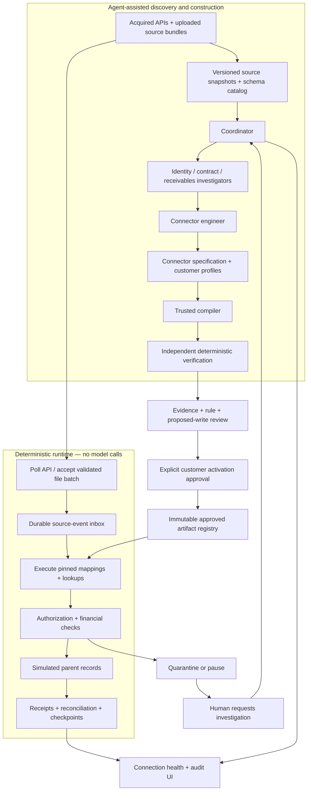
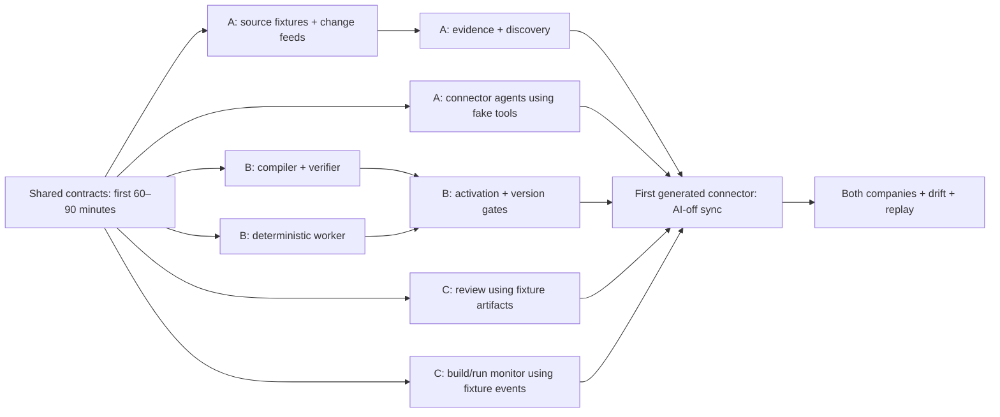

# PRD v2 — Agent-Built Acquisition Connectors

**Date:** November 8, 2026

**Status:** Draft for review; no product implementation is claimed.

**Team:** Three developers, each using coding agents; 2–3 day local prototype.

**Relationship to v1:** This is a standalone replacement design for implementation planning. Preserve `prd.md` as the previous proposal. V2 changes the primary output from a migration package into an executable, approved integration that continues operating without AI.

## 1. Product thesis

**Agents investigate the acquired company's systems, reconstruct their financial meaning, and build a reusable connection to the parent. After verification and approval, ordinary software operates that connection without model calls.**

The product has two distinct phases:

1. **Understand and build:** autonomous agents discover schemas, inspect records and documents, resolve identities, reconstruct business rules, and assemble a connector artifact with evidence and tests.
2. **Operate deterministically:** the approved connector retrieves new records, translates them, checks constraints, synchronizes them into the parent, and reconciles the results. This path has no LLM dependency.

When a new situation falls outside the connector's approved understanding, it is held for review. The system can return to agent-assisted investigation to produce a revised connector; it does not silently ask an LLM to improvise during normal synchronization.

**Pitch:** AI learns how an acquired business's financial systems work and builds the integration; a verified connector keeps those systems connected afterward.

This is stronger than repeatedly interpreting every incoming record: the valuable deliverable is a reusable, inspectable operating artifact. AI is essential during discovery and construction, while its conclusions become explicit rules that people can inspect and ordinary software can execute.

## 2. Confirmed requirements and proposed boundaries

### Confirmed from the discussion

- Two acquired companies, one predefined parent target schema, and a simulated parent system.
- Both uploaded source files and simulated legacy APIs; generated synthetic source data.
- Translation of existing financial systems and records, not issuance of new invoices or real money movement.
- Autonomous product agents whose tasks, collaboration, tools, and findings are visible in the demo.
- Strong deterministic financial tools and an easy review experience.
- **Explicit approval for each customer, authorizing subsequent automatic sync within that customer's approved rules.** The user selected this v2 behavior over approving every sync batch.
- TypeScript/Node.js, local execution, three developers with their own coding-agent teams, and a 2–3 day window.
- Agents build the connection after exploration; ordinary operation must work without AI.

### Proposed implementation defaults

- Unidirectional acquired-system → parent synchronization. Sources remain authoritative for the replicated records; the parent is a downstream representation during the demo.
- Preserve acquired seller legal entities. Acquisition does not automatically reassign contracts or receivables.
- One customer approval unit is one buyer account within one acquired seller entity; a buyer served by both acquisitions needs two approvals.
- Build executable connector specifications compiled into an immutable execution plan by trusted TypeScript tooling. Agent-generated arbitrary JavaScript is outside this prototype.
- Three customers per acquired company, three months of history, fixed monthly contracts, and USD. Optional expansion to six customers each happens only after the core demo works.
- Local reviewer identity and local credentials; no enterprise authentication claim.
- OpenAI as the initial design-time model provider, behind a narrow interface. No model SDK or key in the runtime worker.
- Runtime supports new structured invoices, payments, credits, explicit allocations, and full payment/credit reversals for enrolled customers. It imports source-issued invoices; it does not calculate or issue new invoices itself.
- Newly uploaded unstructured contracts/amendments require investigation and renewed affected-customer approval. Learning one contract does not eliminate the need to interpret future contracts.

These are proposed defaults rather than additional user decisions. In particular, bidirectional writes or arbitrary generated connector code would materially expand this scope.

## 3. What changes from v1

| Area | V1 | V2 |
|---|---|---|
| Primary deliverable | Reviewed migration package | Versioned executable connector plus initial customer reconstruction |
| AI role | Investigate and propose migrations/deltas | Discover, build, test, and repair integration artifacts |
| Routine new records | New reviewed migration work | Deterministic sync under standing customer authorization |
| Approval | Exact customer package; new delta needs approval | Initial customer state plus explicit future-operation scope; revision or scope change needs renewed approval |
| Persistence | Evidence, findings, packages, imports | Also connector registry, activation epochs, inbox, checkpoints, quarantine, and execution receipts |
| Demo proof | Correct import with evidence | Correct import, followed by new data syncing with model access disabled |
| Unexpected changes | Investigation exception | Runtime containment, explicit repair request, new verified connector version |

**Important distinction:** Ordinary new data must not invalidate standing approval merely because the source revision advances. Approval is tied to semantic rules, scope, identities, schema contracts, and connector versions. Routine conforming events are explicitly authorized. A schema, contract, identity, rule, or permission change is not routine data.

## 4. Meaning of “full understanding”

The product cannot prove complete understanding of an entire acquired company. It can establish a **verified operating scope** for specified source entities and transformations.

A connector is eligible for activation only when:

1. Source resources, field types, units, currencies, timestamps, stable IDs, pagination, revision semantics, and target counterparts are documented.
2. Required financial fields and business rules are backed by applicable evidence; unresolved terms are excluded or blocked.
3. Customer/legal-entity identities are reviewed and mapped to stable parent IDs.
4. The supported transformation language can express the mapping without hidden inference.
5. Historical source coverage and control totals reconcile for the enrolled customer.
6. Independent holdout tests cover new records, duplicates, retries, invalid input, ordering, and drift.
7. A dry run reproduces expected target records and shows all proposed writes.
8. The initial bootstrap and its start checkpoint are defined without a data-loss window.
9. The customer reviewer approves the initial state and future sync scope for the exact artifact.

Passing these checks establishes suitability for the tested supported envelope, not universal semantic correctness. A field's meaning can change without its type changing; schema checks alone cannot detect every such change.

## 5. Product outputs

Each acquired company produces a reusable connector definition. Customer-specific identity maps and contract facts are separately versioned profiles bound into each activation.

| Artifact | Contents | Purpose |
|---|---|---|
| Discovery report | Source catalog, target mapping, evidence, assumptions, unresolved questions | Explains what the agents learned |
| Connector specification | Queries, schemas, transformations, joins, incremental semantics, validations, permitted operations | Defines the connection |
| Customer profile | Approved identity map, legal entity, contract versions, recurring configuration, permitted source IDs | Specializes the connector to one reviewed account |
| Compiled execution plan | Normalized ordered operations, pinned runtime/compiler version, hashes | Executes without AI |
| Verification report | Historical replay, holdout results, negative tests, reconciliation, coverage | Supports review; cannot be self-certified by the builder agent |
| Customer activation | Artifact/profile hashes, initial snapshot, baseline parent state, future-operation authority, reviewer, epoch | Authorizes this customer's connection |
| Sync receipt | Source events, artifact version, transformations, target writes, control totals, outcome | Explains every subsequent sync |

A markdown explanation or saved chat transcript is not a connector. The artifact must be sufficient for the worker to run from a clean process without access to discovery conversations or an LLM.

## 6. Approach and tradeoffs

The user selected the architectural goal: agents build the connection, then operation is deterministic. The following implementation approach is a proposal for the short deadline.

| Approach | Value | Cost / limitation |
|---|---|---|
| **Agent-authored executable specification + trusted compiler/runtime** | Produces a working connector; inspectable, bounded, testable; fastest fit for this prototype | Supports only the declared source protocols and transformation operations |
| Agent-generated TypeScript adapters and tests | More flexibility for unusual APIs and business logic | Requires isolated build execution, dependency controls, code review, and more extensive testing |
| Agent-driven mapping on every sync | Flexible handling of unfamiliar records | Does not satisfy the requested AI-free operating path |

**Recommended for v2:** the first approach. Agents genuinely build the integration by selecting source operations, defining mappings, resolving identity tables, establishing change semantics, and producing an executable artifact. Developers provide generic transports and financial primitives. They must not hardcode company-specific final mappings and present them as agent discoveries.

The compiler may emit normalized JSON/bytecode consumed by a TypeScript interpreter. Emitting a `.ts` file is not required for a deterministic connector. Do not introduce dynamic `eval`, arbitrary shell, package installation, or unrestricted SQL to make the demo appear more autonomous.

## 7. Architecture



### Local process boundaries

- **Web:** React/Vite UI for discovery, review, activation, and connection monitoring.
- **Control API:** Node/Fastify, model credentials, agent scheduler, source mocks, discovery/evidence database, compiler orchestration, and immutable artifact files.
- **Runtime worker/API:** separate Node process with no model SDK dependency and no model credentials. Owns `runtime.sqlite`: customer activation state, inbox, checkpoints, receipts, and the simulated parent tables.
- Control API invokes the worker's restricted control routes only for explicit reviewer actions. Product-agent tool registries do not expose activation, revocation, or parent writes.
- Runtime accepts only registered artifact hashes and allowlisted source resources. Source URLs are operator-configured references, not agent-supplied arbitrary URLs. The registry directory is read-only to the worker.
- Source mocks can live in the control API for the demo. “Disable AI” disables the model client/credentials, not the mock source server.
- A single local startup command is a desired deliverable. No Kubernetes, cloud deployment, message broker, or separate vector database.

Separate databases mean no claim of a cross-database atomic transaction. The runtime's activation/import/receipt transaction is authoritative. If the control API loses its response, it queries the worker by idempotency key before retrying and mirrors the returned status.

Runtime performs deterministic financial writes through its own service layer, not through model tools. Local service credentials and a trusted laptop are demo assumptions, not production isolation against a hostile local user.

## 8. Agent team and tool boundaries

| Role | Main task | Output |
|---|---|---|
| Coordinator | Plan discovery, delegate, track unknowns, request focused investigation | Bounded task graph and readiness proposal |
| Identity investigator | Resolve customer aliases and preserve legal entities | Cited identity candidates and approved-map inputs |
| Contract analyst | Reconstruct applicable terms, amendments, and effective dates | Evidence-backed term versions and unsupported-rule flags |
| Receivables investigator | Explain invoices, payments, credits, allocations, and balances | Relationship proposals and reconciliation explanations |
| Connector engineer | Construct the actual connection using discovered source capabilities | Connector specification, profile references, proposed tests, change-handling rules |

Investigators and connector engineer may challenge each other's findings through structured tasks. The coordinator chooses follow-up queries; a fixed script should not predetermine all findings. The runtime never uses agent messages as instructions.

### Design-time tools

- `describeSource(sourceRef)` — schemas, semantics metadata, resources, pagination and changes API.
- `querySnapshot(sourceRef, scope, query)` — bounded captured records, with source revisions and citations.
- `searchEvidence` / `readEvidence` — exact PDF page, CSV row, API field, or exported email.
- `publishFinding` — versioned evidence, alternatives, provenance, and unresolved questions.
- `draftConnector` / `reviseConnector` — structured artifact edits with expected revisions.
- `compileConnector` — static validation and deterministic compilation; no parent writes.
- `runSandboxReplay` — connector execution against snapshots in a disposable target.
- `requestVerification` — runs a protected evaluator; returns results, not hidden expected answers.
- `compareArtifacts` — field/rule/scope and target-output differences between versions.

Agents cannot modify evaluator assertions, read hidden truth, grant approval, activate connectors, retrieve arbitrary secrets, or apply parent transactions. Agent-authored tests are supplementary; passing their own tests is insufficient.

Suggested limits remain four simultaneous model calls, ten specialist tasks per customer investigation, eight tool rounds per task, and two focused repair rounds. Record actual usage and bounded input/output tokens. Exhaustion produces an actionable exception, not an automatic runtime fallback to another model.

### AI-free runtime tools

`fetchChanges`, `validateSourceEnvelope`, `resolveApprovedIdentity`, `executeMapping`, `validateFinancialBatch`, `applyParentBatch`, `reconcileBatch`, `checkpoint`, and `quarantine` are ordinary functions. None can invoke AI, expand its allowed operations, or change a connector rule.

## 9. Connector specification

The specification must contain at least the following sections; unknown required semantics block compilation or activation.

| Section | Required contents |
|---|---|
| Identity | Connector ID/version, source system/entity, parent schema version, compiler/runtime versions |
| Sources | Allowlisted resource references, transport, query templates, pagination and ordering |
| Source contracts | Required fields, types, units, currency, enums, revision/delete semantics, date timezone |
| Change capture | Snapshot watermark, incremental cursor or file-batch IDs, complete-page rules, retry/resume behavior |
| Mapping | Typed target fields, transforms, approved joins, required versus nullable values, per-field lineage |
| Identity resolution | Stable source IDs → approved parent account IDs; unknown IDs held |
| Business rules | Confirmed effective-dated terms/profile references; supported recurring configuration |
| Target operations | Allowlisted inserts/references/reversals; expected version checks; uniqueness constraints |
| Validation | Required rule IDs, balances/control totals, scope checks, material amount and record-count limits |
| Exceptions | Typed error classification, retry eligibility, quarantine scope, stop behavior |
| Provenance | Discovery evidence IDs, immutable snapshot hashes, rule justification, evaluation report |

Example fragment, illustrative rather than a complete schema:

```json
{
  "connectorId": "company-a-finance",
  "version": 1,
  "sourceRef": "legacy-a",
  "direction": "source_to_parent",
  "changeCapture": {
    "kind": "monotonic_sequence",
    "resource": "changes",
    "sequenceField": "sequence"
  },
  "paymentMapping": {
    "sourceId": { "field": "receipt_id" },
    "amountCents": { "op": "decimal_to_minor", "field": "received_amount", "scale": 2 },
    "currency": { "constant": "USD", "evidenceRef": "source-a-currency-contract" },
    "accountId": { "op": "approved_lookup", "table": "customer_account_map", "field": "customer_ref" },
    "invoiceId": { "op": "existing_invoice_lookup", "field": "invoice_ref" }
  },
  "onUnknownCustomer": "quarantine",
  "onSchemaMismatch": "pause_source",
  "runtimeModelCalls": "forbidden"
}
```

The trusted compiler converts this into an ordered executable plan; validates referenced capabilities, fields, types, and dependencies; and computes a canonical hash. Every executed field transformation emits lineage.

Allowed transform primitives: field selection, explicit date parsing, integer/decimal conversion, enum lookup, trim/case normalization for matching, approved constants, approved-key joins, identity lookups, and confirmed effective-interval selection. Monetary operations use integer minor units with overflow checks. No arbitrary expressions or hidden probabilistic matchers.

The runtime loads durable approved knowledge—identity maps, confirmed contract terms, and rules—not a prompt memory. Determinism means identical versioned inputs and state produce the same target mutation plan, independent of model availability.

## 10. Explicit customer approval and activation

An approval covers both the reviewed initial customer reconstruction and **clearly bounded future behavior**. The review screen must explain the second part; do not turn a one-time import approval into invisible ongoing authority.

### Reviewer sees and approves

- Customer identity, acquired seller entity, parent account, and source account IDs.
- Initial historical records, evidence, outstanding balance, and proposed parent representation.
- Exact connector/profile versions and verification results.
- Allowed future record types and target mutations.
- Polling/file ingestion behavior, date/currency assumptions, deterministic allocation rules, and operating limits.
- What automatically syncs, what is held, and how to pause/revoke the connection.

Use **“Approve and enable this customer”** as the explicit action. No “approve all.” The worker receives an expected artifact hash, profile hash, baseline snapshot/watermark, reviewer ID, target baseline version, and idempotency key.

The worker transaction verifies these inputs, imports the reviewed bootstrap state, stores standing authorization and its activation epoch, and records a receipt. Any failure leaves the customer inactive with no partial bootstrap. A lost response is resolved by the receipt's idempotency key.

### What is authorized afterward

- New supported structured source transactions for that existing mapped customer.
- Exact-reference allocations and supported full reversals passing all financial checks.
- Retry/replay of those events without repeated monetary effect.
- Read-only retrieval, synchronization receipts, and control-total checks.

### What requires renewed approval or new enrollment

- A new customer account or a changed legal-entity/identity mapping.
- A connector/profile revision affecting that customer's fields, rules, or authority.
- New/changed binding contract terms, prices, or unsupported transaction semantics.
- A different parent schema, broadened endpoint access, or new target mutation type.
- Material corrections to previously imported monetary history beyond explicit source reversals.

Every routine row does not require approval. Every routine row still requires deterministic validation. Supported-looking rows that exceed configured amount or count limits are held, not silently approved. Proposed demo defaults are USD 50,000 maximum per transaction and 1,000 records per cycle; these are operational scope limits, not measures of correctness.

Revocation increments an activation epoch. A transaction checks current active status and epoch immediately before commit, so work fetched earlier cannot commit under revoked authority. Pause stops new application of records while preserving receipts and pending work. Source reads may continue only to capture durable evidence, with that behavior visible.

## 11. Steady-state synchronization

### Source A: structured API

The mock API provides a consistent snapshot at sequence `S` and an ordered changes feed after `S`. Include stable event IDs, record IDs, record versions, and a complete-page cursor. The specification must encode these capabilities; a generic `updated_at > last_time` filter is insufficient for backdated or equal-timestamp changes.

1. Agent discovery and bootstrap review use snapshot `S`.
2. Initial activation imports that reviewed snapshot.
3. The runtime fetches events strictly after `S`, including events that arrived while review was pending.
4. Events within the approved scope are applied; relevant metadata/contract drift is held before applying affected work.

All required schema, contract, and profile changes in the mocks must appear in a revision/manifest feed. Activation preflight verifies that no intervening semantic change invalidates the reviewed profile. Routine new financial events do not invalidate it and are consumed after activation.

### Source B: recurring file exports plus receipt API

Support sequential CSV export batches with a batch manifest: source/export version, monotonically increasing batch sequence, required field schema, stable transaction IDs, event/revision IDs, and content hash. The receipt API follows the same durable ingestion model as A.

For this prototype, recurring CSV batches are **append-only event exports**, not arbitrary full-table replacements. Re-uploading an identical batch is a no-op. Reusing a batch ID with different bytes is a conflict. Missing prior batches are visible gaps. Changing a previously imported transaction's contents without an explicit supported reversal is held.

Company B's source simulator must publish a coordinated immutable `BootstrapManifest` from one canonical fixture epoch. It identifies the complete baseline CSV batch IDs/hashes and final batch sequence, the receipt API snapshot and resume cursor, the schema/contract semantic versions, and the semantic-change-feed cursor. The baseline is ready for review only after every manifest member is captured and the combined financial view reconciles. Record a vector of per-stream positions; do not invent a single timestamp or cursor that represents all feeds. After activation, each stream resumes strictly after its own manifest position.

Every subsequent financial event/batch declares its required source-schema and semantic revision. The worker checks those dependencies before applying it. If a governing revision is unseen, changed, or not approved for the customer, hold the event even if its financial feed arrives before the metadata feed. This ordering contract is provided by the synthetic source coordinator; obtaining equivalent guarantees from real acquired systems is separate connector work. Freeze this multi-stream manifest contract in S0.

Legacy rows without reliable transaction identities can be investigated in discovery, but they are not eligible for unattended ongoing sync until a verified stable-key rule exists. Row numbers and filenames alone cannot identify economic transactions across successive exports.

New contracts/PDFs/email files are evidence arrivals, not deterministic financial events. They can be captured and hashed without AI; their interpretation requires a separate investigation. If a document cannot be scoped to a known customer safely, pause the affected source's financial stream rather than assuming it is irrelevant.

### Durable inbox and checkpoints

Maintain two distinct positions:

- **Capture cursor:** highest contiguous source page/batch durably stored in the inbox.
- **Application state:** per-event outcome and the highest contiguous applied/explicitly resolved position, with counts of pending/quarantined gaps.

Persist a fetched page and its capture cursor in the same transaction. Apply each customer transaction group, its target changes, receipt, idempotency records, and event outcome in one transaction in `runtime.sqlite`. Never advance capture before saving the events, and never report full application while quarantine gaps exist.

Rows may arrive twice; processing is at least once, while unique source transaction identities and transactional application prevent repeated financial effects in the simulator. The identity key excludes connector version, so upgrading does not turn historical events into new transactions.

If a payment references an invoice not yet available, keep it pending for bounded dependency retries. If the dependency remains absent, quarantine it with the source IDs needed to resolve it. Independent customers may continue when the affected scope is known. A customer with unresolved ordering or monetary dependencies is held; later dependent events cannot jump ahead and create a misleading balance.

A dependency hold pauses unsafe application, not ingestion of the missing prerequisite. Continue capturing later events; when the referenced invoice arrives, form a validated dependency group, apply it in topological order, and then release the payment. Do not deadlock the customer by refusing to process the very invoice that resolves the hold. Cycles or inconsistent prerequisite data remain explicit exceptions.

Transient transport errors retry with bounded exponential backoff. Data/schema failures do not retry indefinitely. A source schema failure stops interpretation of that feed; opaque bytes may be retained, but its application checkpoint cannot advance as if successful.

### Parent writes and source authority

The parent simulator is read-only to users for source-owned financial fields during steady-state sync. Review actions produce new profile/rule proposals, not direct edits to replicated monetary values. If an external/conflicting parent edit is detected by version checks, hold the affected customer rather than overwrite it.

The simulator's parent records, receipts, and runtime state share a transactional database. A future real ERP will require its own idempotent write API, outbox/retry handling, and post-write reconciliation; this demo does not prove atomic delivery across unrelated systems.

## 12. Financial integrity and evidence

Preserve separate original, interpreted, reviewed, and imported records. Every target value links to a source snapshot or a reproducible derivation and to the connector version that produced it.

- Never fabricate payments, invoices, credits, adjustments, opening transactions, or contract terms.
- Use integer minor units, explicit currency, typed dates, safe numeric bounds, and explicit effective intervals.
- An invoice's outstanding balance is its effective amount less applicable payment/credit allocations, accounting for supported reversal effects.
- Unallocated cash remains separate. No fuzzy allocation or model prediction in steady state.
- Allocations cannot exceed payment/credit availability or invoice balance and must remain within the approved seller/customer/currency scope.
- Support full payment/credit reversals only, including reversal of all associated allocations. Preserve originals; partial, invoice, or reversal-of-reversal operations are held.
- Import detailed historical transactions once. Opening and cutover balances are derived checks, not extra monetary postings.
- Distinguish financial effective time, source observation time, and connector/application version. A backdated event may change the latest reconstruction of an earlier balance while preserving the original approved snapshot.
- Binding contract terms and amounts must be observed in applicable evidence or deterministically derived. Reviewer-confirmed identity/schema relationships may remain explicitly inferred; unsupported amounts cannot become facts through approval.
- Provenance uses separate `origin` (agent/deterministic/reviewer), `class` (observed/derived/inferred/unresolved), `evidenceStatus`, and `reviewDisposition`.
- A resolving citation proves the source exists, not that the model interpreted it correctly. Review and independent checks are still necessary.

At every cycle, show captured, applied, pending, and quarantined record counts and amounts. Reconciliation totals disclose coverage. “Connected” does not mean every record is resolved, and an active source with quarantined records is not labeled fully reconciled.

## 13. Drift, repair, and version changes

| Change | Detection | Runtime response |
|---|---|---|
| Normal new invoice/payment with known schema and customer | Existing contract, lookup, and rule checks | Apply automatically |
| Unknown customer | Approved lookup miss | Hold that customer's events; require enrollment |
| Renamed/removed field, changed unit/type, new material enum | Source contract/version checks | Pause affected source mapping before writes |
| New contract/amendment or changed profile manifest | Document/profile version change | Hold affected customer; request review |
| Same types but implausible amounts or inconsistent totals | Financial invariants and configured bounds | Quarantine/hold with evidence |
| Same-shape semantic change that satisfies all checks | May be undetectable | Explicit limitation; rely on declared source contracts, change notification, and periodic human review |
| Source timeout or throttling | Transport error | Bounded retry; report lag |
| Target record version conflict | Expected-version check | Hold affected customer; no silent overwrite |

Repair lifecycle:

1. Capture evidence and classify the break; do not call AI from the worker.
2. Reviewer explicitly requests agent investigation in the control application.
3. Agents inspect the new schema/evidence and draft version `N+1`.
4. Independent verification reruns old regression cases and new drift fixtures; compare output differences.
5. Each affected customer reviews and approves the revised artifact/profile. Unaffected customers remain pinned to their previous activation.
6. Worker pauses the customer's application, drains/stops in-flight work, and atomically switches the pinned version/activation epoch at a defined boundary.
7. Previously held input is revalidated from the durable inbox. Source-identity deduplication still applies across versions.

Demonstrate a nonfinancial schema rename repair, not retrospective rewriting of imported monetary amounts. If a changed mapping would reinterpret already-applied money, produce a correction proposal and hold it; automatic historical restatement is outside the MVP.

Switching back to an older connector version changes future execution only and requires compatibility checks and approval. It does not undo already committed financial records. Never call this an automatic financial rollback.

## 14. User interface and observable proof

### Discovery/build workspace

- Source coverage and financial relationship explorer.
- Live agent task graph or timeline, messages, tool calls, evidence, findings, and blockers.
- Connector artifact viewer: source operation → transformation → parent field.
- Proposed rule and profile changes, generated tests, and independent test results shown separately.
- Explicit unresolved/unsupported rules, with affected customers and records.

### Customer activation review

- Source-to-parent preview, baseline balances, citations, identity/contract decisions.
- A readable future-sync authorization summary, including limits and stop conditions.
- Explicit per-customer “Approve and enable” action and visible artifact version.
- Corrections with evidence and rationale; changes rerun verification and stale the prior candidate approval.

### Connection operations workspace

- Customer activation status, pinned connector/profile versions, last successful fetch/apply, and source/application lag.
- New records, pending dependencies, quarantined items, retries, reconciliation results, and last receipt.
- Deterministic rule trace for every applied record.
- Pause/revoke and request-investigation actions.
- Separate counters for **design-time model calls** and **runtime model calls**, with the latter required to stay zero.

The zero-call label must be backed by architecture and a test: run the worker without model keys, fail any attempted model invocation in the test harness, and successfully sync records introduced after activation. A cached replay or precomputed transaction list is not evidence of AI-free ongoing operation.

## 15. Shared data and API contracts

| Contract | Key fields |
|---|---|
| `ConnectorSpec` | ID/version, source/target contracts, capabilities, capture semantics, mappings, validators, limits |
| `CompiledArtifact` | Spec hash, compiler/runtime versions, normalized plan, profile dependencies, content hash |
| `CustomerProfile` | Customer/seller scope, identity maps, contract facts, evidence, version/hash |
| `VerificationReport` | Artifact hash, fixture/harness versions, passed/failed checks, coverage, unexplained differences |
| `CustomerActivation` | Customer, artifact/profile hashes, baseline watermark/target version, allowed operations, limits, reviewer, epoch, status |
| `SourceEvent` | Source/entity/event ID, record ID/version, sequence, effective/observed times, content hash, payload ref |
| `BootstrapManifest` | Common fixture epoch, baseline file IDs/hashes, per-API snapshot/resume positions, schema/semantic revisions, semantic-feed position |
| `InboxOutcome` | Event, captured/applied/pending/quarantined state, dependency IDs, reason, attempt |
| `SyncReceipt` | Customer, event group, activation epoch, artifact hash, mutation plan, applied IDs, control totals |
| `ConnectionCheckpoint` | Per-stream capture cursor vector, customer application progress, semantic revisions, unresolved gaps |
| `ActivityEvent` | Monotonic UI cursor, phase build/run, actor/task/customer, type, timestamp, structured payload |

Core interfaces agreed before parallel implementation:

- `compile(spec, profiles) -> artifact | diagnostics`
- `verify(artifact, snapshot, protectedFixtureSet) -> report`
- `planBatch(artifact, profile, sourceEvents, targetState) -> deterministicPlan | holds`
- `activateCustomer(expectedHashes, snapshot, reviewer, idempotencyKey) -> activationReceipt`
- `applyBatch(plan, expectedActivationEpoch, idempotencyKeys) -> syncReceipt`

Control routes cover source upload, discovery runs/events, connector revisions/verification/diffs, and reviewer actions. Worker routes cover activation, pause/revoke, run-once/poll controls, connection status, receipts, and read-only parent views. Agents receive only the design-time tool subset, not arbitrary HTTP access to those routes.

Secrets are runtime references provisioned by the operator; agents cannot embed tokens in specifications. A rotated secret may retain the same approved capability reference; expanded endpoint permissions require new review. Do not persist credentials in source artifacts, prompts, event logs, or browser bundles.

## 16. Stack and constraints

Keep the previously proposed TypeScript stack: React/Vite, Fastify, Zod, SQLite, local evidence files, PDF.js for text PDFs, pdf-lib for synthetic documents, Vitest, and Playwright. The only significant runtime addition is a separate deterministic worker process and its persistent inbox/checkpoints.

Dependency versions, model ID, SQLite driver, and CSS components are builder choices pinned at setup. No new orchestration framework is required. Use shared types and runtime schemas across the control API, worker, and UI.

Use short transactions within each SQLite database, with one application service owning writes to each. The simulator can commit target updates and receipts atomically because they share `runtime.sqlite`; [SQLite documents its transaction guarantees](https://www.sqlite.org/transactional.html). Do not infer cross-database atomicity from WAL; [SQLite explicitly distinguishes that limitation](https://www.sqlite.org/wal.html).

Source validators must explicitly define required fields, types, enum policy, and additional-field behavior. [JSON Schema defaults do not make declared properties required or automatically forbid extra fields](https://json-schema.org/understanding-json-schema/reference/object). The demo uses strict reviewed source shapes; schema changes pause affected mappings until reviewed.

Exclusions: real ERP writes, bidirectional synchronization, newly issued invoices, money movement, production identity/authentication, arbitrary code generation/execution, fine-tuning, OCR, tax/FX/revenue recognition, and universal connectors. Users must approve and scope real integrations separately after the prototype.

## 17. Synthetic data and demo

Generate canonical financial truth and an observable-evidence manifest first, then produce two differently structured source systems. Keep both outside agent retrieval; expose only the distorted sources. Use a seeded reference calculator independent of the connector interpreter.

- **Company A:** API customers/invoices/payments and change feed; uploaded contract PDFs and one executed amendment.
- **Company B:** recurring CSV event exports with different names/units, receipt API, contract PDFs, and exported email context.
- Three customer accounts each initially; one overlapping buyer identity across acquired sellers without pooling their balances.
- Baseline includes an explained account, a resolved contract amendment, an ambiguous remittance held for evidence, and a same-name legal-entity collision.
- Holdout records arrive after compilation/approval and are not part of the discovery snapshot.

### Required 6–8 minute demo

1. Show the two different source structures and parent schema.
2. Start agent discovery; inspect a useful cross-agent investigation and its source evidence.
3. Show the resulting connector artifact, compiled mappings, and independent verification report.
4. Explicitly approve one customer from each company and show the initial parent reconstruction.
5. **Disable model access.** Inject a new source-issued invoice, a payment, and a fresh Company B CSV event batch after activation. Both connectors translate supported records automatically; model-call count remains zero.
6. Replay a payment and restart the worker; show no duplicate financial effect and resumed pending work.
7. Introduce a renamed source field. Show the affected stream pause before applying bad data while an independent connection remains healthy.
8. Optional third-day extension: explicitly re-enable design-time AI, build a revised connector, approve the affected customer, and replay held records through the revised deterministic connection.

Use an illustrative $3,000 invoice, $2,000 payment, and $200 credit for an $800 opening receivable. A new $300 payment effective after cutover yields a $500 current balance without changing the original cutover balance. A newly issued invoice in the source increases parent receivables through import, not through product-issued billing.

A labeled captured-run replay is a presentation fallback only. Acceptance requires actual new post-activation inputs syncing with AI disabled.

## 18. Three-developer plan and agent teams

| Owner | Responsibility | Suggested coding-agent assignments | Owned areas |
|---|---|---|---|
| **Developer A** | Discovery and connector construction | A1 source mocks/fixtures/ingestion; A2 investigator/coordinator workflow; A3 connector engineer prompts and live evaluation | `packages/sources`, `packages/discovery`, fixture generators |
| **Developer B** | Deterministic connector platform | B1 shared schemas/compiler; B2 runtime inbox/checkpoints/transactions; B3 independent financial verifier and negative tests | `packages/contracts`, `packages/compiler`, `packages/runtime`, `packages/finance`, `packages/parent`, protected evaluator |
| **Developer C** | Review, activation, observability, demo | C1 discovery/artifact review; C2 runtime health/receipts; C3 browser flows and no-AI demo tests | `apps/web`, typed API client, `tests/e2e`, demo scripts |

Each human owns integration and review of their agent team's work. Independent coding agents can work concurrently in separate worktrees/modules. Avoid concurrent edits to shared schemas or lockfiles. B owns shared contracts and runtime composition; A exposes source/discovery plugins; C consumes typed clients.

A can develop against fake compiler/verifier tools, B against fixture connector specifications, and C against fake artifacts/events. Hand-authored specifications are development fixtures and must be labeled as such; the final live demo uses agent-produced specifications.

### Work packages

| ID | Owner | Deliverable | Dependencies |
|---|---|---|---|
| S0 | All; B records | Freeze source-event, multi-stream bootstrap manifest, artifact, profile, activation, plan, receipt, and UI-event contracts | None |
| A1 | A | Two mock sources, snapshot/change semantics, visible/hidden fixture separation | S0 |
| A2 | A | Evidence ingestion/retrieval and autonomous investigation | S0; A1 sample records |
| A3 | A | Agent-built connector specification and focused repair loop | S0; compiler mock initially |
| B1 | B | Compiler, mapping interpreter, financial checks, protected test harness | S0; hand-authored dev fixtures |
| B2 | B | Worker, inbox, capture/apply state, idempotency, parent simulator | S0; compiled fixture initially |
| B3 | B | Customer activation, epochs, quarantine, artifact version checks | B1+B2 |
| C1 | C | Artifact/customer review and explicit activation | S0; typed fixtures |
| C2 | C | Agent timeline and deterministic connection monitor | S0; event/receipt fixtures |
| I1 | All | First agent-built connector activated and syncing a new record without AI | A2+A3+B1+B2+B3+C1+C2 |
| I2 | All | Second source format, drift containment, restart/replay demonstration | A1+I1 |



### Schedule and fallback scope

- **First 60–90 minutes:** agree typed contracts, one worked connector fixture, source semantics, approval boundaries, and module ownership.
- **Day 1:** A builds minimal discovery/connector output; B implements the minimal compiler/worker/activation path; C implements review and event views against mocks. Exit: one generated connector handles one post-activation record with AI disabled.
- **Day 2:** add the second source format, supported transaction relationships, bounded automatic sync, schema drift containment, replay/restart tests, and a complete rehearsal. Freeze features in the second half of the day.
- **Optional Day 3:** demonstrate agent-assisted repair/reapproval, improve evidence navigation, run additional holdout variants, and rehearse on the laptop.

If behind, reduce source documents, customer count, supported amendment variants, and graphical UI polish. Keep two source companies, both file/API ingestion, explicit customer enrollment, an agent-built executable artifact, actual no-AI ongoing sync, financial checks, idempotency, and visible drift containment. Full automated repair is the first feature deferred; containment is required.

## 19. Acceptance criteria

| Test | Required result |
|---|---|
| Artifact sufficiency | Worker starts with artifact/profile/source credentials only; no discovery conversation needed |
| AI-off proof | Model client disabled and worker lacks keys; new post-activation records from both source types still sync |
| Genuine generation | Final artifact comes from live agent construction using source schemas/evidence, not a hidden company-specific lookup |
| Customer approval | Unapproved customer cannot bootstrap or receive future writes |
| Standing authority | Conforming future records for an enrolled customer sync without additional reviewer clicks |
| Scope expansion | Unknown customer, legal-entity change, or new material rule is held |
| Artifact tampering | Hash/runtime-version mismatch blocks activation/execution |
| Financial integrity | Exact expected balances; no unsupported monetary transaction or guessed allocation |
| Replay/concurrent delivery | One economic effect per source transaction identity, across retries and connector versions |
| Crash boundaries | Crash before commit has no target effect; after commit retry returns receipt; captured pending events survive |
| Snapshot-to-stream gap | Events arriving during approval are fetched after baseline watermark; none silently lost |
| Company B multi-stream bootstrap | All baseline files/API snapshots match the manifest epoch; each stream resumes from its own cursor without omission or double import |
| Semantic-feed ordering | Financial event requiring an unseen/changed contract revision is held even if it arrives before the metadata event |
| Quarantine progress | Capture may advance only after durable storage; application gap remains visible and not falsely complete |
| Missing dependency | Payment before invoice waits; invoice can still be captured and applied to release it; unresolvable reference held without consuming funds |
| CSV identity | Repeated identical batch is no-op; changed bytes for same batch ID held; missing batch visible |
| Drift | Field/schema/profile change stops affected processing before writes; independent scope can continue |
| Revocation race | An in-flight plan cannot commit after its activation epoch is revoked |
| Prompt injection | Source text cannot activate a connection, expand tools, change approved rules, or access hidden truth |
| Independent evaluation | Connector builder cannot edit mandatory tests or inspect expected holdout answers |
| Historical evidence | Original approval snapshot and new as-of reconstruction both remain inspectable |

Run deterministic tests without model credentials. Run separate live-model construction tests against held-out source variants; report generated-artifact failures and correct abstentions, not only successful cases. Require at least one successful independently checked live connector build per source company and three full demo rehearsals before presenting reliability claims.

Metrics: time to verified connector, unresolved rules, customer enrollments, initial reconciliation differences, steady-state model calls (target zero), captured/applied/quarantined counts, sync latency, duplicate effects (target zero), drift incidents, and repair/reapproval duration when demonstrated. Finite tests support a prototype claim, not universal correctness or production readiness.

## 20. Product risks and limitations

- **A wrong rule can be consistently wrong.** Independent holdouts, financial controls, and evidence review matter more than the fact that runtime is deterministic.
- **Stable schemas can conceal changed meaning.** Require source semantic/version contracts and make detection limits explicit.
- **Unstructured new agreements still require understanding.** Capture them without AI, hold affected scope, and return to discovery when requested.
- **Synthetic data can make success misleading.** Generate canonical truth first, distort sources separately, and test previously unseen variants and post-activation records.
- **Connector generation is not universal API integration.** Demo transports are generic supported primitives; real authentication, pagination peculiarities, and target write semantics need separate engineering.
- **Standing approval must be visible and revocable.** Reviewers authorize defined future behavior, not unrestricted autonomous financial actions.
- **Bidirectional sync changes the problem.** Conflict resolution, ownership, echo prevention, and writeback authorization are deferred.

V2 preserves the original objective—correct translation into the parent—while making the durable connection the product. The prototype is complete only when the agents can stop and the approved connection keeps working within its verified scope.
